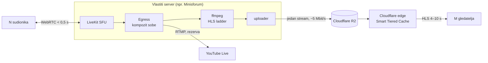

# ss-meetcast

Open source „Google Meet + YouTube" na vlastitom hardveru:

- **N ljudi u sobi** razgovara uživo, s kašnjenjem ispod pola sekunde
  ([LiveKit](https://github.com/livekit/livekit), WebRTC SFU).
- **M gledatelja** prati isti razgovor kao prijenos, s kašnjenjem od 4–10 s,
  preko Cloudflare edgea, tako da trošak ne raste s brojem gledatelja.

Repo je tehnička osnova. Namjenski proizvodi (npr. molitvena mreža) nastaju
kasnije kao derivati.

> **Status:** istraživanje. Kod još ne postoji; dokumenti u `docs/` su
> odluke i izračuni, ne mjerenja.

## Arhitektura

Glavne odluke:

| Pitanje | Odluka | Zašto |
|---|---|---|
| Video za sobu | LiveKit (Apache 2.0), self-hosted | SFU + SDK-ovi, ugradnja u vlastiti UI, Egress za snimanje i prijenos |
| Server | lokalni x86 (Minisforum), bez clouda | usko grlo je upload veze, ne CPU |
| Distribucija gledateljima | HLS u R2 iza Cloudflare cachea | R2 egress je besplatan, R2 vidi ~1 dohvat po objektu, ne po gledatelju |
| Zašto ne Free CDN ispred servera | Cloudflare uvjeti zabranjuju video na Free CDN-u | R2 (Developer Platform) je dopušten |
| Rezerva | isti Egress šalje i na YouTube | besplatno, nosi masu ako naš put padne |

## Dokumenti

| Dokument | Sadržaj |
|---|---|
| [Platforme i video tehnologija](docs/2026-10-25-istrazivanje-platformi-i-video-tehnologije.md) | postojeće platforme, LiveKit vs Jitsi/BBB/OpenVidu, kapacitet lokalnog servera, x86 ili ARM |
| [Distribucija kroz Cloudflare edge](docs/2026-10-26-distribucija-kroz-cloudflare-edge.md) | zašto YouTube skalira, uvjeti korištenja, kašnjenje, trošak po broju gledatelja, alternative |
| [R2 operacije i cache](docs/2026-10-26-r2-operacije-i-cache.md) | tri razine cachea, izračun operacija, što kvari cache, napadi na račun |
| [HLS pipeline: implementacija](docs/2026-10-26-hls-pipeline-implementacija.md) | Egress, ffmpeg, uploader, R2 i Cloudflare postavke, player, plan testiranja |

Preporučeni redoslijed čitanja je odozgo prema dolje.

## Kapacitet ukratko

| | Ograničava | Red veličine |
|---|---|---|
| Soba (N) | upload servera i paketi/s kroz router | desetci s videom, stotine do tisuće samo audio |
| Prijenos (M) | Cloudflare, ne mi | od stotina do milijuna; iznad ~PB na sat Cloudflare će tražiti ugovor |

## Sljedeći koraci

1. LiveKit, Egress, MediaMTX i ffmpeg u Dockeru na Minisforumu; izmjeriti CPU.
2. R2 bucket, custom domena i Cloudflare pravila; provjera `cf-cache-status`.
3. Load test sa stotinama HLS klijenata; R2 Class B operacije moraju ostati ravne.
