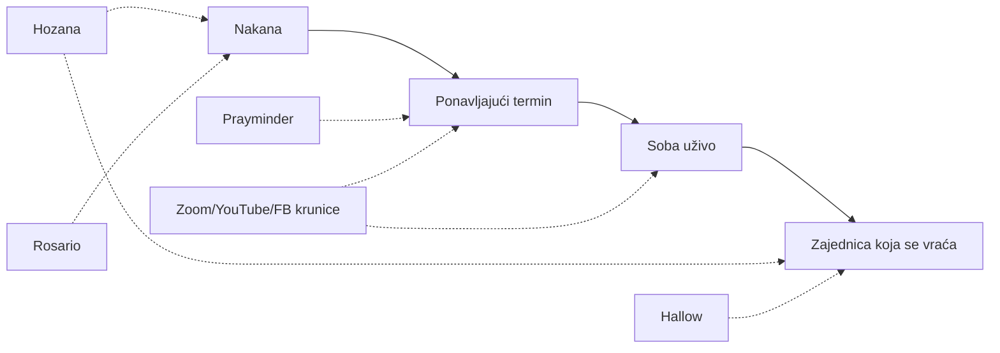

# Istraživanje: postojeće katoličke molitvene platforme i open source video

Datum: 2026-10-25. Izvor: web pretraga (uglavnom sažeci). Brojke korisnika i
termini događaja **nisu provjereni** na službenim stranicama, a neki su iz
2020.–2024.

## Ideja

Globalna društvena mreža koja okuplja N ljudi oko M molitvenih nakana. Uz svaku
nakanu postoji redoviti virtualni događaj, na primjer krunica za mir u svijetu
svake srijede u 21:00, na koji ljudi dolaze u video ili audio sobu i mole zajedno.

## Zaključak

Nijedan pronađeni projekt ne spaja **nakanu, ponavljajući termin, sobu uživo i
zajednicu koja se vraća**. Postojeći projekti pokrivaju jedan dio:

### Mreže oko nakana, bez videa

- **Hozana** (FR, laici, katolička i ekumenska): oko 1 M članova, preko 1.000
  zajednica (župe, biskupije, redovi, pojedinci). Članovi dobivaju objave
  zajednice, posjetitelji ostavljaju nakane (2021.: oko 700 nakana dnevno).
  Moderacija je stroga: politika i komercijala su zabranjeni. Nema susreta uživo.
  Konceptualno je najbliža ideji. <https://hozana.org/en/page/about>
- **Rosario** (tim Hozane): digitalna „živa krunica" (Pauline Jaricot). Grupe
  od 5, svatko dnevno moli deseticu, otajstva se dodjeljuju automatski, grupa se
  veže uz nakanu. Moli se asinkrono. <https://apps.apple.com/app/id1619096568>
- **Hallow**: najveća katolička aplikacija (oko $70 godišnje). Župne zajednice,
  nakane do 240 znakova s gumbom „Pray for All", sezonski izazovi (Pray25,
  Pray40). Sadržaj je snimljen, nema soba uživo.
- **Prayminder** (SE, Prayminder AB, dvoje ljudi): osobni popis nakana s
  podsjetnicima (dnevno, tjedno, točan termin). Besplatna, bez reklama, a
  molitve ostaju na uređaju. Navode 27–30 M izmoljenih molitava. Nema zajedničkih
  popisa ni sinkronizacije. Za ideju je zanimljiv njihov tok podsjetnika: kod
  nas bi podsjetnik vodio ravno u zajednički termin. **Ime „Prayminder" je
  zauzeto.** Postoji i zasebna „Prayer Minder" drugog autora.
  <https://apps.apple.com/us/app/prayminder/id1309466339>
- **Click To Pray** (Papina svjetska molitvena mreža): mjesečne papine nakane i
  eRosary narukvica. Moli se pojedinačno. Mogući partner ili izvor nakana.

### Krunice uživo, ali na tuđim alatima

Stotine pojedinačnih inicijativa: Paradisus Dei (Zoom petkom, link mailom),
St. Therese (Zoom, pon–pet 21:00 EST), Catholic Online (YouTube srijedom, nakane
se čitaju naglas), EWTN, župe sa Zoom krunicom na prijavu, povremene vatikanske
svjetske krunice za mir.

Zajednički problemi: nema kataloga termina, linkovi se dijele mailom, nema veze
s nakanom ni kontinuiteta, vremenske zone svaki organizator rješava sam.

### Mali pokušaji iste ideje

Orabimus (krunica u pregledniku i soba uživo, izgleda kao projekt jednog
developera), RosaryOn (iOS, tjedne krunice posvećene zemljama). Kod protestanata:
Church App i 3-16 Prayer Network (audio sobe), Pray.com (feed nakana). Nijedan
od katoličkih pokušaja nije dosegao vidljivu veličinu.

### Hrvatska

Nije pronađena online platforma. Postoje javne krunice na trgovima (prva subota)
i žive krunice po župama.

## Izbor video tehnologije

**Pravi P2P (mesh) ne dolazi u obzir.** Radi do otprilike 4–6 sudionika, jer
svatko šalje stream svakome. Treba **self-hosted SFU**, a snimanje se radi na
serveru.

| | LiveKit | Jitsi Meet | BigBlueButton | MiroTalk |
|---|---|---|---|---|
| Licenca | Apache 2.0 | Apache 2.0 | LGPL | AGPL |
| Što je | SFU + SDK-ovi | gotova aplikacija | virtualna učionica | gotova aplikacija |
| Ugradnja u vlastiti UI | odlična | iframe, izgleda kao Jitsi | teška | srednja |
| Snimanje | Egress (MP4, HLS, samo audio, stream) | Jibri: jedan Chrome po snimci, teško skalirati | ugrađeno | osnovno |

**Odluka (prijedlog): LiveKit.** Razlozi:

- soba je model platforme (nakana i termin), a tokeni i uloge (predvoditelj
  objavljuje, ostali slušaju) dolaze iz našeg backenda;
- audio-only način s puno slušatelja odgovara krunici;
- snimanje samo zvuka je jeftino;
- LiveKit Cloud za početak, self-host kasnije bez promjene koda.

Jitsi samo kao brzi MVP za provjeru dolaze li ljudi svaki tjedan.

Napomene:

- TURN (LiveKit ga ima ugrađenog) je nužan za mobilne i korporativne NAT-ove.
- Snimka molitve je podatak o vjerskom uvjerenju (GDPR čl. 9.). Treba izričita
  privola i vidljiva oznaka snimanja, a po defaultu bi se snimao samo predvoditelj.
- Kapacitet: 4 vCPU podnosi stotine audio ili desetke video sudionika. Ovo je
  gruba procjena, nije izmjereno.

## Otvoreno

- Ime projekta (Prayminder je zauzeto).
- Potvrditi odluku LiveKit ili Jitsi MVP.
- Kostur: LiveKit u Dockeru, backend koji izdaje tokene po nakani i terminu,
  jednostavan web klijent.
- Repo još nema remote.
