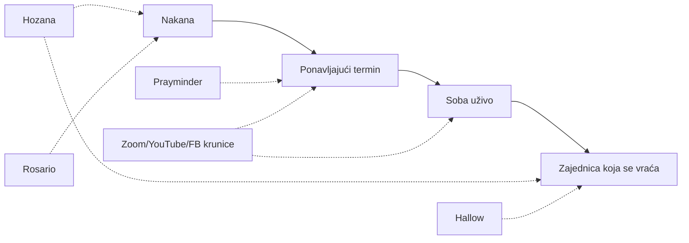
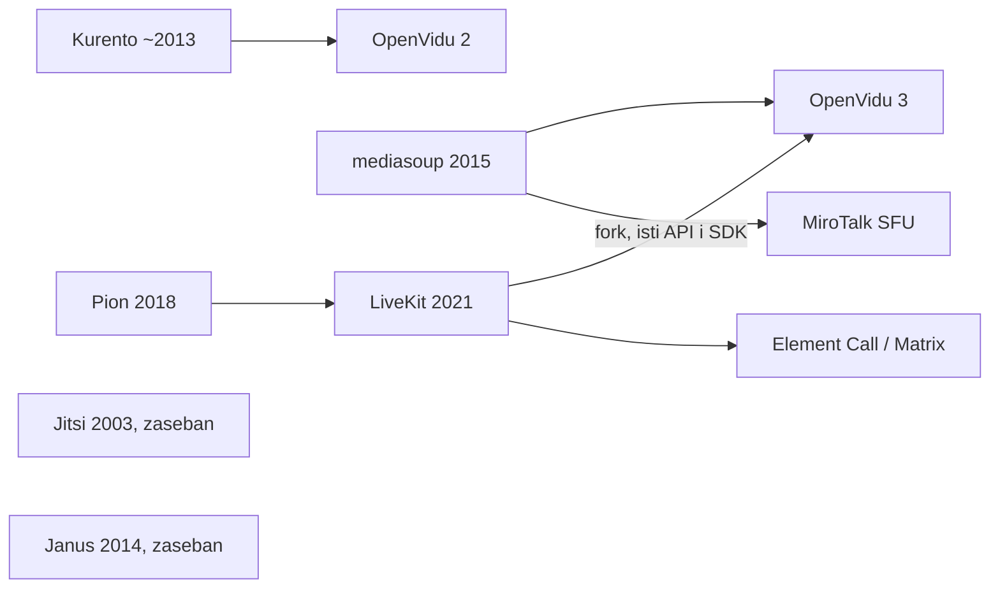

# Istraživanje: postojeće katoličke molitvene platforme i open source video

Datum: 2026-10-25. Izvor: web pretraga (uglavnom sažeci). Brojke korisnika i
termini događaja **nisu provjereni** na službenim stranicama, a neki su iz
2020.–2024.

## Ideja

Globalna društvena mreža koja okuplja N ljudi oko M molitvenih nakana. Uz svaku
nakanu postoji redoviti virtualni događaj, na primjer krunica za mir u svijetu
svake srijede u 21:00, na koji ljudi dolaze u video ili audio sobu i mole zajedno.

## Zaključak

Nijedan pronađeni projekt ne spaja **nakanu, ponavljajući termin, sobu uživo i
zajednicu koja se vraća**. Postojeći projekti pokrivaju jedan dio:



### Mreže oko nakana, bez videa

- **Hozana** (FR, laici, katolička i ekumenska): oko 1 M članova, preko 1.000
  zajednica (župe, biskupije, redovi, pojedinci). Članovi dobivaju objave
  zajednice, posjetitelji ostavljaju nakane (2021.: oko 700 nakana dnevno).
  Moderacija je stroga: politika i komercijala su zabranjeni. Nema susreta uživo.
  Konceptualno je najbliža ideji. <https://hozana.org/en/page/about>
- **Rosario** (tim Hozane): digitalna „živa krunica" (Pauline Jaricot). Grupe
  od 5, svatko dnevno moli deseticu, otajstva se dodjeljuju automatski, grupa se
  veže uz nakanu. Moli se asinkrono. <https://apps.apple.com/app/id1619096568>
- **Hallow**: najveća katolička aplikacija (oko $70 godišnje). Župne zajednice,
  nakane do 240 znakova s gumbom „Pray for All", sezonski izazovi (Pray25,
  Pray40). Sadržaj je snimljen, nema soba uživo.
- **Prayminder** (SE, Prayminder AB, dvoje ljudi): osobni popis nakana s
  podsjetnicima (dnevno, tjedno, točan termin). Besplatna, bez reklama, a
  molitve ostaju na uređaju. Navode 27–30 M izmoljenih molitava. Nema zajedničkih
  popisa ni sinkronizacije. Za ideju je zanimljiv njihov tok podsjetnika: kod
  nas bi podsjetnik vodio ravno u zajednički termin. **Ime „Prayminder" je
  zauzeto.** Postoji i zasebna „Prayer Minder" drugog autora.
  <https://apps.apple.com/us/app/prayminder/id1309466339>
- **Click To Pray** (Papina svjetska molitvena mreža): mjesečne papine nakane i
  eRosary narukvica. Moli se pojedinačno. Mogući partner ili izvor nakana.

### Krunice uživo, ali na tuđim alatima

Stotine pojedinačnih inicijativa: Paradisus Dei (Zoom petkom, link mailom),
St. Therese (Zoom, pon–pet 21:00 EST), Catholic Online (YouTube srijedom, nakane
se čitaju naglas), EWTN, župe sa Zoom krunicom na prijavu, povremene vatikanske
svjetske krunice za mir.

Zajednički problemi: nema kataloga termina, linkovi se dijele mailom, nema veze
s nakanom ni kontinuiteta, vremenske zone svaki organizator rješava sam.

### Mali pokušaji iste ideje

Orabimus (krunica u pregledniku i soba uživo, izgleda kao projekt jednog
developera), RosaryOn (iOS, tjedne krunice posvećene zemljama). Kod protestanata:
Church App i 3-16 Prayer Network (audio sobe), Pray.com (feed nakana). Nijedan
od katoličkih pokušaja nije dosegao vidljivu veličinu.

### Hrvatska

Nije pronađena online platforma. Postoje javne krunice na trgovima (prva subota)
i žive krunice po župama.

## Izbor video tehnologije

**Pravi P2P (mesh) ne dolazi u obzir.** Radi do otprilike 4–6 sudionika, jer
svatko šalje stream svakome. Treba **self-hosted SFU**, a snimanje se radi na
serveru.

| | LiveKit | Jitsi Meet | BigBlueButton | MiroTalk |
|---|---|---|---|---|
| Licenca | Apache 2.0 | Apache 2.0 | LGPL | AGPL |
| Što je | SFU + SDK-ovi | gotova aplikacija | virtualna učionica | gotova aplikacija |
| Ugradnja u vlastiti UI | odlična | iframe, izgleda kao Jitsi | teška | srednja |
| Snimanje | Egress (MP4, HLS, samo audio, stream) | Jibri: jedan Chrome po snimci, teško skalirati | ugrađeno | osnovno |

**Odluka (prijedlog): LiveKit.** Razlozi:

- soba je model platforme (nakana i termin), a tokeni i uloge (predvoditelj
  objavljuje, ostali slušaju) dolaze iz našeg backenda;
- audio-only način s puno slušatelja odgovara krunici;
- snimanje samo zvuka je jeftino;
- LiveKit Cloud za početak, self-host kasnije bez promjene koda.

Jitsi samo kao brzi MVP za provjeru dolaze li ljudi svaki tjedan.

Napomene:

- TURN (LiveKit ga ima ugrađenog) je nužan za mobilne i korporativne NAT-ove.
- Snimka molitve je podatak o vjerskom uvjerenju (GDPR čl. 9.). Treba izričita
  privola i vidljiva oznaka snimanja, a po defaultu bi se snimao samo predvoditelj.
- Kapacitet: 4 vCPU podnosi stotine audio ili desetke video sudionika. Ovo je
  gruba procjena, nije izmjereno.

## Provjera LiveKita i konkurencije (2026-10-25)

### Porijeklo

LiveKit (2021., Russ d'Sa i David Zhao) nije izveden iz Jitsija. Napisan je
od nule u Go-u na **Pionu** (WebRTC biblioteka za Go). Nasljeđuje iskustvo
starijih SFU-ova (simulcast, model sobe), ali s njima ne dijeli kod.



### GitHub (stanje 2026-10-25, `gh api`)

Svi projekti su aktivni (zadnji push u listopadu 2026., nijedan nije arhiviran).

| Repo | ★ | Licenca | Napomena |
|---|---:|---|---|
| jitsi/jitsi-meet | 30.142 | Apache-2.0 | gotova aplikacija |
| livekit/livekit | 21.810 | Apache-2.0 | SFU server |
| pion/webrtc | 16.853 | MIT | biblioteka, temelj LiveKita |
| livekit/agents | 14.934 | Apache-2.0 | AI sudionici |
| bigbluebutton/bigbluebutton | 9.252 | LGPL-3.0 | učionica |
| meetecho/janus-gateway | 9.193 | GPL-3.0 | C, plugini |
| versatica/mediasoup | 7.405 | ISC | SFU biblioteka |
| miroslavpejic85/mirotalksfu | 3.136 | AGPL-3.0 | aplikacija na mediasoupu |
| jitsi/jitsi-videobridge | 3.107 | Apache-2.0 | Jitsijev SFU |
| OpenVidu/openvidu | 2.138 | Apache-2.0 | fork LiveKita |
| jech/galene | 1.425 | MIT | mali Go SFU |
| livekit-examples/meet | 977 | Apache-2.0 | primjer aplikacije za sastanke |
| Kurento/kurento | 442 | Apache-2.0 | i dalje se održava (push 2026-10-15) |
| livekit/egress | 372 | Apache-2.0 | snimanje |

Ispravak ranije tvrdnje: **Kurento nije napušten**, i dalje dobiva commitove.
Malen je i rijetko se bira za nove projekte.

### OpenVidu 3

Prema vlastitoj dokumentaciji, OpenVidu 3 je **fork LiveKita, 100%
kompatibilan po API-ju i SDK-ovima**. Koristi standardne `livekit-client` i
`livekit-server-sdk`. Kao media engine nudi Pion (kao LiveKit) ili
**mediasoup**, za koji tvrde da podnosi otprilike 2× više trackova na istom
stroju. To je njihov benchmark, ne neovisan. U paketu su Egress, Ingress,
S3-kompatibilna pohrana i admin dashboard. Ranije je OpenVidu prešao s
Kurenta na mediasoup, a zatim integrirao LiveKit.

Posljedica: kod pisan za LiveKit SDK radi i na OpenVidu 3. To je izlaz ako
self-hostani LiveKit postane premalo učinkovit ili ako zatreba komercijalna
podrška.

### Što je samo u LiveKit Cloudu

- **Napredno uklanjanje šuma** (Krisp, BVC, ai-coustics): ugrađeni modeli traže
  da media ide kroz LiveKit Cloud. Self-host dobiva standardno WebRTC
  uklanjanje šuma u pregledniku. ai-coustics radi i self-hostano, ali uz
  vlastitu licencu. Postoje open source dodaci: RNNoise
  (`livekit/agents` PR #6477) i DTLN (`aloware/livekit-plugins-dtln`).
  Jedan GitHub issue navodi da Krisp od svibnja 2026. postaje plaćen, što nije
  provjereno u službenom cjeniku.
- **Telefonija (SIP)**: Krisp na SIP trunku je samo u Cloudu.
- **Analitika**: Cloud ima dashboard (Analytics API na Scale planu). Kod
  self-hosta je to vlastito rješenje (Prometheus i slično).

Za krunicu je to prihvatljivo: predvoditelju je važna dobra slušalica s
mikrofonom, a ostali su većinom slušatelji. RNNoise se može dodati kasnije.

### Izvori

- <https://docs.livekit.io/transport/self-hosting/>
- <https://livekit.com/blog/noise-cancellation>
- <https://community.livekit.io/t/is-krisp-noise-cancellation-available-with-livekit-cloud/78>
- <https://github.com/livekit/agents/pull/6477>, <https://github.com/livekit/agents/issues/5507>
- <https://github.com/aloware/livekit-plugins-dtln>
- <https://openvidu.io/openvidu-vs-livekit/>, <https://openvidu.io/3.8/docs/comparing-openvidu/>
- <https://docs.openvidu.io/en/stable/openvidu3/>

## Otvoreno

- Ime projekta (Prayminder je zauzeto).
- Potvrditi odluku LiveKit ili Jitsi MVP.
- Kostur: LiveKit u Dockeru, backend koji izdaje tokene po nakani i terminu,
  jednostavan web klijent.
- Repo još nema remote.

## Kapacitet lokalnog servera (Minisforum, bez clouda)

### Polazište: službeni LiveKit benchmark

Mjereno na GCP `c2-standard-16` (16 vCPU = 8 fizičkih jezgri):

| Scenarij | Objavljuju | Primaju | Ulaz / izlaz | Paketa/s izlaz | CPU |
|---|---:|---:|---|---:|---:|
| Audio | 10 | 3000 | 7,3 kB/s / 23 MB/s | 959.156 | 80% |
| Sastanak 720p | 150 | 150 | 50 MB/s / 93 MB/s | 762.749 | 85% |
| Prijenos 720p | 1 | 3000 | 233 kB/s / 531 MB/s | 560.962 | 92% |

Izvedeno po sudioniku: audio slušatelj oko **61 kbit/s**, gledatelj 720p
oko **1,4 Mbit/s**, sudionik sastanka s videom oko **5 Mbit/s prema sebi** i
**2,7 Mbit/s od sebe** (simulcast).

Jedna soba mora stati na jedan čvor. Egress traži **4 CPU i 4 GB RAM-a po
instanci**, a kompozitno snimanje troši 2–6 CPU i snima jednu sobu po
instanci. Track egress (bez transkodiranja) je gotovo besplatan.
<https://docs.livekit.io/transport/self-hosting/benchmark/>,
<https://docs.livekit.io/transport/self-hosting/egress/>

### Gdje je usko grlo

Usko grlo je **upload kućne veze**, ne CPU. 8 jezgri gura 4,2 Gbit/s
(prijenos), a kućni upload je 100–1000 Mbit/s. Drugo usko grlo su
**paketi u sekundi kroz kućni router**: 1000 audio slušatelja znači otprilike
320k paketa/s, što potrošački ISP router (NAT, conntrack) obično ne izdrži.

### Formula

```
izlaz servera = Σ_po_sudioniku Σ_tracka_koje_prima bitrate
koristivo     = 0,7 × upload veze
```

**Zamka zajedničke molitve:** ako svi imaju uključen mikrofon, broj audio
streamova raste s **N·(N−1)**, odnosno kvadratno. LiveKit ne miješa zvuk (nije
MCU). Usto se kod 20 i više ljudi koji istovremeno odgovaraju uz različite
latencije (50–300 ms) čuje „jeka zbora". Prijedlog: predvoditelj i 2–4
mikrofona za odgovaranje su uključeni, ostali su utišani i mole uz njih.

### Procjena po scenariju (70% uploada)

| Scenarij | 100 Mbit/s | 250 Mbit/s | 500 Mbit/s | 1 Gbit/s |
|---|---:|---:|---:|---:|
| A: 1 predvoditelj audio, slušatelji (61 kbit/s) | ~1.150 | ~2.850 | ~3.000 (CPU) | ~3.000 (CPU) |
| B: predvoditelj 720p video + audio (1,4 Mbit/s) | ~50 | ~125 | ~250 | ~500 |
| C: svi s videom, mreža pločica (5 Mbit/s) | ~14 | ~35 | ~70 | ~140 |
| D: svi s uključenim mikrofonom (~40 kbit/s po streamu, N²) | ~42 | ~66 | ~93 | ~132 |

Brojke su **ukupno za sve sobe istovremeno**, ne po sobi. Ako u srijedu u
21:00 rade tri krunice, dijele isti upload. Za scenarij C treba i download
(N × 2,7 Mbit/s).

CPU granica za A iz benchmarka vrijedi za 8 fizičkih jezgri. Minisforum s
14–16 jezgri (MS-01 i9-13900H, MS-A2 Ryzen 9 9955HX) trebao bi imati
otprilike 1–2× tu granicu. Ovo je procjena, nije izmjereno.

### RAM (procjena, LiveKit ne objavljuje brojke)

| Komponenta | RAM |
|---|---:|
| Linux + Docker | 2 GB |
| LiveKit server + Redis | 2–4 GB |
| Aplikacija + Postgres | 4 GB |
| Egress, kompozitno snimanje (po istovremenoj snimci) | 4 GB |
| Rezerva | 25% |

**32 GB** pokriva 2 istovremene video snimke, **64 GB** 4–5 snimaka. Snimanje
samo zvuka ne povećava RAM primjetno.

### Disk

| Snimka | Bitrate | Po satu |
|---|---:|---:|
| Audio track (Opus) | 32 kbit/s | ~14 MB |
| Miješani audio sobe | 64–128 kbit/s | 29–58 MB |
| Video kompozit 720p | ~2,5 Mbit/s | ~1,1 GB |
| Video kompozit 1080p | ~4,5 Mbit/s | ~2 GB |

Primjer: 20 krunica dnevno po 30 min. Samo zvuk daje oko 0,6 GB dnevno, odnosno
oko 210 GB godišnje. Video 720p daje oko 11 GB dnevno, odnosno oko 4 TB
godišnje. NVMe od 2 TB i lokalni backup (NAS) dovoljni su za zvuk. Za video
treba politika brisanja ili veći disk.

### Mreža i infrastruktura

- **Javna IPv4 adresa, ne CGNAT**, idealno statička (inače DDNS). Domena i
  TLS (Let's Encrypt).
- Portovi: TCP 443 (signalizacija i TURN/TLS), TCP 7881, UDP 7882 (UDP mux)
  ili raspon 50000–60000, UDP 3478 (TURN).
- Vlastiti router (OPNsense/pfSense) ili ISP router u bridge načinu, zbog
  paketa u sekundi.
- UPS. Kućna veza i struja su jedna točka kvara.
- Provjeriti uvjete ISP-a za hosting na privatnom priključku. Za javni servis
  je bolja poslovna linija sa statičkom IP adresom.
- Latencija iz Amerike do Hrvatske je oko 120–200 ms, što je za molitvu
  prihvatljivo.

### Kako izmjeriti umjesto procjene

`lk load-test --audio-publishers 1 --subscribers 500` (i varijante za scenarije
B, C i D) s drugog stroja na drugoj mreži, uz praćenje CPU-a, uploada i paketa
u sekundi na routeru. Zatim zamijeniti procjene u ovoj tablici mjerenjima.

### x86 ili ARM

Predloženi MS-A2 (AMD Ryzen 9 9955HX) i MS-01 (Intel i9-13900H) su **x86-64**.

LiveKit radi i na ARM-u. Docker Hub (provjereno 2026-10-25): `livekit/livekit-server`,
`livekit/egress`, `livekit/ingress` i `redis` imaju slike za `amd64` i `arm64`.

Minisforumov ARM model je **MS-R1**: CIX P1 (CP8180), 12 jezgri (8× A720 i
4× A520), 64 GB LPDDR5 zalemljeno, oko £585 za 64 GB / 1 TB. Dolazi s
prilagođenim Debianom 12.
<https://www.cnx-software.com/2025/11/11/500-minisforum-ms-r1-arm-linux-ai-mini-pc-features-cix-cp8180-12-core-soc-up-to-64gb-lpddr5x/>,
<https://www.linuxlinks.com/minisforum-ms-r1-arm-workstation-running-linux-introduction/>

**Odluka (prijedlog): x86 za produkcijski server.** Razlozi:

- Driveri za MS-R1 još nisu u glavnom kernelu. Minisforum preporučuje svoju
  sliku sustava, pa ovisimo o njima za sigurnosne nadogradnje kernela, a to je
  loše za javno izložen server.
- Ekosustav oko LiveKita (headless Chrome u Egressu, Postgres, monitoring) je
  bolje testiran na x86.
- Prednost ARM-a je potrošnja struje, a usko grlo je upload veze, ne CPU.

ARM ima smisla za eksperimente ili drugi čvor, ili ako potrošnja 24/7 postane
važna. Treba ga ponovno razmotriti kad CIX driveri uđu u glavni kernel.
