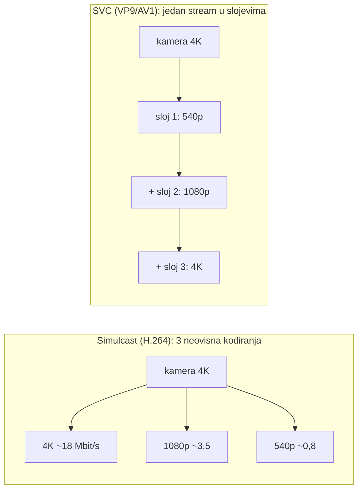
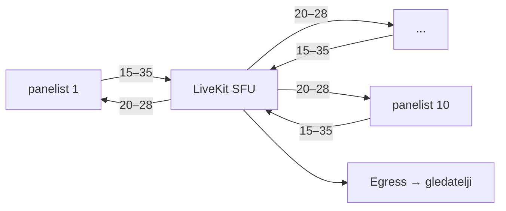
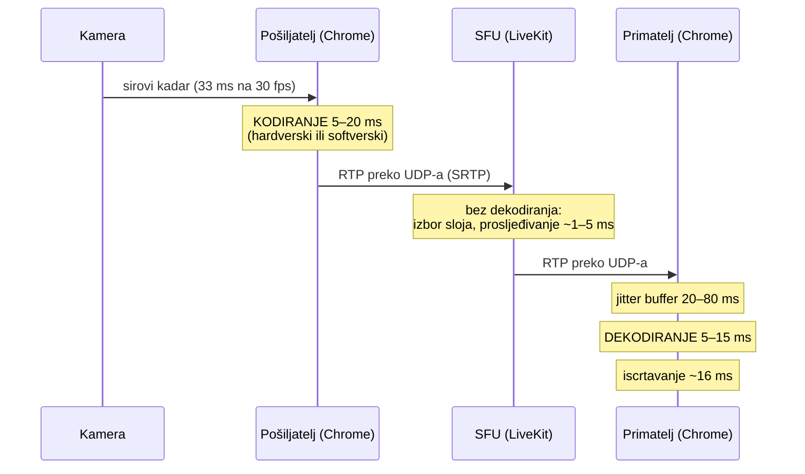
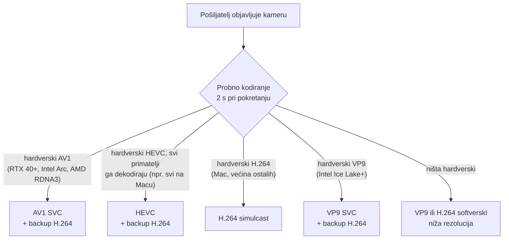

# 4K panel: upload, download, server i tko troši CPU

Datum: 2026-10-26. Brojke su **procjene** za „talking head" (čovjek pred
kamerom, malo pokreta) na 30 fps, nisu izmjerene. Za 60 fps računaj ~1,5×.

## Zaključak

- 4K u sobi je izvedivo: LiveKit ne ograničava rezoluciju, ograničavaju je
  Meet i Zoom svojim pravilima.
- Svaki panelist treba **≥ 25–50 Mbit/s uploada** (ovisno o kodeku), žičano,
  na optici ili kabelu.
- Download panelista je ~20–28 Mbit/s, jer 4K prima samo govornika preko cijelog
  ekrana, a ostale u nižoj rezoluciji.
- Server za 10 panelista: ~150–350 Mbit/s ulaza i ~200–280 Mbit/s izlaza.
- Usko grlo je **4K prema gledateljima**: Egress kompozit radi u Chromeu i
  softverski. Rješenje je hardverski enkoder (iGPU) ili prijenos tracka
  govornika bez kompozita.
- Server ne dekodira video (SFU samo prosljeđuje pakete). CPU troše **pošiljatelj
  (kodiranje) i primatelj (dekodiranje)**, a ventilator najčešće pale
  softversko kodiranje i efekti poput zamućenja pozadine.

## Upload po panelistu

| Kodek (4K30) | Glavni sloj | S nižim slojevima | Preporučeni upload |
|---|---:|---:|---:|
| H.264 (hardverski, najšira podrška) | 15–25 Mbit/s | +30% simulcast → 20–33 | **≥ 50 Mbit/s** |
| VP9 SVC | 10–15 Mbit/s | +15% → 12–17 | **≥ 30 Mbit/s** |
| AV1 SVC | 6–12 Mbit/s | +15% → 7–14 | **≥ 25 Mbit/s** |

Rezerva od ~2× postoji zbog:

- **ključnih kadrova**: u 4K jedan ima 1–2 MB, što je na 30 Mbit/s skok od
  ~0,3 s;
- **kontrole zagušenja**: WebRTC (GCC) na prvi jitter spušta kvalitetu, pa bi
  bez rezerve panelist većinu vremena slao 1080p.

VDSL (10–20 Mbit/s uploada), mobilna mreža i Wi-Fi ne prolaze.

### Simulcast i SVC



SFU primatelju šalje samo slojeve koje treba. Simulcast znači tri kodiranja na
pošiljatelju; SVC jedno, ali ga hardver rjeđe podržava.

## Download panelista: nitko ne treba 9 × 4K

Na 4K ekranu u mreži 3×3 pločica je ~1280×720, pa 4K u pločici ne donosi ništa.

| Prikaz | Što prima | Download |
|---|---|---:|
| govornik preko cijelog ekrana + 8 pločica | 1 × 4K + 8 × 540p | ~20–28 Mbit/s |
| mreža 3×3 | 9 × 720p | ~15–25 Mbit/s |
| svi u 4K | 9 × 4K | ~135 Mbit/s |

## Server (Minisforum) za panel od 10



| | Iznos (Mbit/s) |
|---|---:|
| Ulaz, download veze | 10 × 15–35 ≈ 150–350 |
| Izlaz, upload veze | 10 × 20–28 ≈ 200–280 |

Stane na 500 Mbit/s uploada, a na 250 Mbit/s je na rubu.

## 4K prema gledateljima

- **Egress kompozit** iscrtava sobu u headless Chromeu i kodira softverski;
  zadani preseti idu do 1080p. 4K kompozit u realnom vremenu na mini PC-u
  vjerojatno ne ide bez hardverskog enkodera (ffmpeg s VAAPI ili QSV na iGPU-u).
  Treba provjeriti što konkretni Minisforum podržava i izmjeriti.
- **Bez kompozita**: Track Egress uzme 4K track govornika i prepakira ga bez
  dekodiranja (vidi niže), a ffmpeg od njega radi ladder.
- **Promet**: 4K HLS je ~15–20 Mbit/s (H.264) ili ~8–12 (HEVC/AV1). Milijun
  gledatelja je ~7 PB na sat; za tisuće gledatelja i dalje praktički besplatno
  ([trošak](2026-10-26-distribucija-kroz-cloudflare-edge.md#trošak-po-broju-gledatelja)).

## Tko troši CPU: kodiranje, dekodiranje, transkodiranje

Tri različite operacije:

| Operacija | Što radi | Tko je radi u SFU sobi | Cijena |
|---|---|---|---|
| **kodiranje** | sirovi pikseli kamere → H.264/VP9/AV1 | pošiljatelj, uvijek | najskuplje; ×3 kod simulcasta |
| **dekodiranje** | H.264/VP9/AV1 → pikseli za ekran | primatelj, za svaki stream koji prikazuje | jeftinije, obično hardverski |
| **transkodiranje** | dekodiranje + ponovno kodiranje u drugi format | **nitko** (to radi MCU ili Egress) | najskuplje i dodaje kašnjenje |

„Bez transkodiranja" znači da **server ne dira piksele**. SFU prima RTP
pakete, odluči kojem primatelju šalje koji sloj, prepiše zaglavlja i proslijedi.
Zato jedan SFU podnosi tisuće streamova i dodaje tek milisekunde.

Primatelj ne transkodira, nego **dekodira**: svaki dolazni stream pretvori u
piksele i nacrta. Audio (Opus) dekodiranje i miješanje 9 glasova je zanemarivo.



Ukupno ~100–250 ms od kamere do ekrana, uz mrežu od 10–50 ms u svakom smjeru.

### Zašto kodiranje kod pošiljatelja ne kvari latenciju

Kodiranje se ne može izbjeći: sirovi 4K30 je ~6 Gbit/s. Realtime enkoder radi
kadar po kadar (bez gledanja unaprijed) i treba milisekunde. Kašnjenje HLS-a
od nekoliko sekundi ne dolazi od kodiranja, nego od **segmenata i buffera**.

Kad bi server transkodirao (MCU: dekodira sve, složi jednu sliku, kodira je
ponovno), dodao bi ~50–200 ms i trebao bi puno CPU-a po sobi. To je razlog
zašto LiveKit (i Meet) rade kao SFU.

UDP je bitan jer izgubljeni paket ne zaustavlja sve iza sebe (kao u TCP-u).
WebRTC ga pokuša nadoknaditi (NACK, FEC) ili preskoči, a jitter buffer
izglađuje neravnomjerne dolaske.

### Zašto se u Google Meetu pali ventilator

Po redu vjerojatnosti:

1. **Efekti**: zamućenje ili zamjena pozadine i poboljšanje svjetla rade
   segmentaciju na svakom kadru.
2. **Softversko kodiranje**: Meet koristi VP8/VP9 (i AV1) u simulcastu. Ako
   računalo nema hardverski enkoder za taj kodek, Chrome kodira 2–3 sloja na
   procesoru.
3. **Softversko dekodiranje** puno pločica u VP9/AV1 bez hardverske podrške.
4. Iscrtavanje mreže pločica (uglavnom na GPU-u, jeftinije).

Za 4K panel to znači: **H.264 s hardverskim enkoderom kod pošiljatelja** i
hardverskim dekoderom kod primatelja. AV1 samo gdje hardver to podržava
(npr. NVIDIA RTX 40 i noviji za kodiranje).

### Kako provjeriti na svom računalu

`chrome://webrtc-internals` za vrijeme poziva, u statistici `outbound-rtp` i
`inbound-rtp`:

- `encoderImplementation` / `decoderImplementation`: hardverski
  (npr. VideoToolbox na macOS-u, „ExternalEncoder", MediaFoundation) ili
  softverski (`libvpx`, `libaom`, OpenH264);
- `powerEfficientEncoder` / `powerEfficientDecoder`: `true` znači hardver;
- `qualityLimitationReason`: `cpu` ili `bandwidth` pokazuje zašto je kvaliteta
  spuštena.

## Razlika između kodeka

| | H.264 (AVC) | VP9 | AV1 | HEVC (H.265) |
|---|---|---|---|---|
| Nastao | 2003., MPEG/ITU | 2013., Google | 2018., AOMedia | 2013., MPEG/ITU |
| Licenca | patentni pool, u browseru praktično besplatan | bez naknada | bez naknada | skupi patenti, više poolova |
| Bitrate za istu kvalitetu | 100% | ~60–70% | ~50% | ~50–60% |
| Hardversko kodiranje | skoro svaki uređaj | rijetko | samo novije grafike (RTX 40+, Intel Arc, AMD RDNA3) | Apple, NVIDIA, Intel, AMD |
| Hardversko dekodiranje | svugdje | većina | novije (Apple M3+) | Apple, većina novijih |
| SVC | ne, samo simulcast | da | da | ograničeno |
| WebRTC podrška | svugdje | Chrome, Firefox, Safari | Chrome, Firefox, Safari na novijem hardveru | tek odnedavno, slaba |

- **H.264**: najmanje učinkovit, ali se svugdje kodira hardverski. Zadani izbor
  za 4K panel.
- **VP9**: trećinu manji bitrate i SVC, ali se kodira softverski. Tu se pali
  ventilator u Meetu.
- **AV1**: najbolja kompresija; softverski je preskup (vidi mjerenje), pa samo
  gdje ga hardver kodira.
- **HEVC**: kompresija kao AV1 i na Macu potpuno hardverski, ali drugi
  sudionici ga u WebRTC-u često ne mogu primiti. Za panel nepouzdan, za HLS
  prema gledateljima dobar.

## Mjerenje: Mac mini M4 Pro, Brave (2026-10-26)

Stroj: Apple M4 Pro, 12 CPU jezgri (8P + 4E), 16 GPU jezgri, 24 GB, macOS 26.5.

`brave://gpu`, Video Acceleration Information:

| | Hardversko dekodiranje | Hardversko kodiranje |
|---|---|---|
| H.264 (baseline, main, high) | do 4096×4096 | **do 4096×2304, 120 fps** |
| VP9 (profile 0, 2) | do 4096×4096 | **nema** |
| AV1 (main) | do 8192×8192 | **nema** |
| HEVC (main, main 10) | do 8192×8192 | **do 8192×4352, 120 fps** |

WebRTC poziv unutar stranice sam sa sobom (canvas 3840×2160 kao izvor, 30 fps,
početni bitrate prisiljen na 15 Mbit/s kroz `x-google-start-bitrate`), CPU svih
Brave procesa iz `top` svake 2 s. Samo iscrtavanje canvasa troši ~40%, to je
osnovica.

| Kodek | Postignuto | Bitrate | CPU Brave (prosjek) | Kodiranje |
|---|---|---:|---:|---|
| HEVC | 4K, 30 fps | ~9 Mbit/s | ~42% | hardver |
| H.264 | 4K, 30 fps | ~16 Mbit/s | ~67% | hardver |
| VP9 | 4K, 30 fps | ~18 Mbit/s | ~150% | softver, ~1,5 jezgre |
| AV1 | 4K, 30 fps | ~13 Mbit/s | ~350% | softver, ~3,5 jezgre |

Napomene:

- H.264 potvrđen iz `brave://webrtc-internals` (rtcstats dump):
  `encoderImplementation: "VideoToolbox"`, `powerEfficientEncoder: true`,
  `decoderImplementation: "ExternalDecoder (VideoToolboxVideoDecoder)"`,
  `powerEfficientDecoder: true`. Dump treba spremiti dok je veza otvorena ili
  kao „rtcstats dump"; „webrtc-internals dump" nakon zatvaranja je prazan.
- `navigator.mediaCapabilities.encodingInfo` za H.264 vraća
  `powerEfficient: false`, iako ga `brave://gpu` i CPU pokazuju kao hardver.
  Tom API-ju se za H.264 ne može vjerovati.
- Brave skriva `encoderImplementation` i `powerEfficientEncoder` u `getStats`
  dok stranica nema dozvolu za kameru; vidljivi su u `brave://webrtc-internals`.
- `totalEncodeTime` po kadru ne razlikuje hardver od softvera: kod hardvera
  uključuje čekanje u redu enkodera (HEVC ~23 ms po kadru uz najmanji CPU).
- Kad tab nije u fokusu, Brave guši timere na 1 kadar u sekundi; mjerenje mora
  teći dok je tab aktivan.
- Bitrate canvasa nije bitrate kamere: sintetička slika s puno pokreta, pa
  stvarni talking head treba manje.

## Zašto Google Meet na Macu kodira softverski

Google Meet nema nativnu macOS aplikaciju; „Install app" je PWA u istom
Chromium engineu. Chromium na Macu koristi hardver koji postoji (VideoToolbox
za H.264 i HEVC, vidi mjerenje), ali **Apple Silicon nema hardverski VP9 ni
AV1 enkoder**. Pitanje je zato zašto Meet na Macu ne šalje H.264. Vjerojatni
razlozi (zaključak, nije javno dokumentirano):

1. **Googleov trošak je mreža, korisnikov je CPU.** VP9/AV1 trebaju 30–50%
   manje bitratea, što je na stotinama milijuna sudionika ogromna ušteda.
2. **SVC**: VP9 i AV1 ga imaju, H.264 u WebRTC-u nema, a infrastruktura je
   građena oko SVC-a.
3. **Hardverski H.264 enkoderi su nepredvidljivi** za realtime (rate control,
   niski bitrate, razlike među driverima); softverski VP9 je isti svugdje.
4. **Dijeljenje ekrana**: AV1 ima alate za tekst i sučelje (screen content coding).
5. **Strategija**: VP8/VP9/AV1 su Googleovi kodeci bez licencnih naknada.
6. **Mac je manjina** korisnika.

Kod 10 panelista dodatni bitrate H.264 je zanemariv, pa mi možemo birati
kodek koji štedi korisnikov CPU.

## Izbor kodeka po uređaju

SFU ne transkodira, pa **svaki primatelj mora znati dekodirati kodek
pošiljatelja**. LiveKit zato dopušta rezervni kodek (`backupCodec`):
pošiljatelj objavi primarni kodek i drugi, široko podržan, a SFU svakom
primatelju šalje onaj koji može dekodirati.



Odluka se ne smije temeljiti na `navigator.mediaCapabilities` (za H.264 na
Macu krivo javlja softver). Pouzdano je kratko probno kodiranje i čitanje
`encoderImplementation`, `powerEfficientEncoder` i CPU-a, kao u mjerenju gore.

## Vizija: nativne aplikacije za macOS i Windows

Cilj: aplikacija koja na svakom stroju koristi sav dostupni hardver, s
maksimalnom fleksibilnošću. Server (LiveKit) i protokol ostaju isti za web i
nativne klijente, pa web klijent može biti prvi, a nativni dolaze kasnije bez
promjene servera.

### Hardver po platformi

| Platforma | API | H.264 | HEVC | VP9 | AV1 |
|---|---|---|---|---|---|
| macOS (Apple Silicon) | VideoToolbox | kodira, dekodira | kodira, dekodira | dekodira | dekodira (M3+) |
| Windows, NVIDIA | NVENC / NVDEC | da | da | dekodira | kodira od RTX 40 |
| Windows, Intel | Quick Sync (QSV) | da | da | kodira od Ice Lake | kodira od Arc / Meteor Lake |
| Windows, AMD | AMF / VCN | da | da | dekodira | kodira od RDNA3 |

Na Windowsima Media Foundation daje zajednički sloj iznad svih triju, a izravni
NVENC/QSV/AMF daju više kontrole. Generacije u tablici su iz poznavanja
hardvera i treba ih provjeriti za konkretne uređaje.

### Što nativna aplikacija može, a browser ne (ili teže)

- **Zero-copy**: kadar iz kamere ili ekrana (ScreenCaptureKit na macOS-u,
  Windows Graphics Capture) ide kao GPU površina (IOSurface, D3D11 tekstura)
  izravno u enkoder, bez kopiranja kroz CPU.
- **Izravan izbor enkodera** i njegovih postavki (rate control, ključni
  kadrovi, 10-bit HEVC, HDR), umjesto onoga što browser odluči.
- **Lokalna snimka u punoj kvaliteti** po panelistu (npr. 4K HEVC ili ProRes
  na disk), poslana nakon emisije za montažu. Prijenos uživo ide kroz WebRTC,
  a snimka ne ovisi o mreži.
- **Dijeljenje ekrana na 60 fps** s hardverskim kodiranjem i samo promijenjenim
  dijelovima.
- **Zvuk**: sistemska obrada glasa (Apple Voice Processing, Windows
  Communications) i niža latencija od browsera.

### Opcije izvedbe

| Pristup | macOS | Windows | Hardver | Napor |
|---|---|---|---|---|
| Web / PWA | Chromium ili Safari | Chromium | što browser dopusti | najmanji |
| Electron | Chromium | Chromium | isto kao browser | mali, ali bez dobitka u kodecima |
| Tauri | WKWebView (Safari WebRTC) | WebView2 (Chromium) | ovisi o platformi | mali, nejednak |
| Flutter desktop + LiveKit Flutter SDK | libwebrtc | libwebrtc | koliko SDK izloži | srednji |
| **Zajednička jezgra u Rustu (LiveKit Rust SDK) + nativni UI** (SwiftUI, WinUI) | libwebrtc + vlastiti enkoderi | libwebrtc + vlastiti enkoderi | puna kontrola | najveći |
| LiveKit Swift SDK (macOS) + Rust/C++ (Windows) | libwebrtc | libwebrtc | puna kontrola | najveći, dva koda |

**Prijedlog**: web klijent prvi (isti server, brza provjera ideje), zatim
nativna aplikacija sa zajedničkom jezgrom u Rustu i nativnim UI-jem po
platformi. Koje hardverske enkodere LiveKit Rust i Swift SDK danas izlažu
(VideoToolbox HEVC, NVENC, QSV, AMF) treba provjeriti u njihovim repozitorijima
prije odluke.

## Oprema panelista

- Kamera i svjetlo važniji su od rezolucije. „4K" web kamera s malim senzorom
  u tamnoj sobi izgleda lošije od dobre 1080p kamere. Za pravi 4K: mirrorless
  kamera preko HDMI grabbera ili kamera tipa Elgato Facecam Pro, plus svjetlo.
- Žičana mreža, ne Wi-Fi.
- Računalo s hardverskim H.264 enkoderom (gotovo sva novija).

## LiveKit klijent (skica)

```ts
await room.localParticipant.setCameraEnabled(true, {
  resolution: { width: 3840, height: 2160, frameRate: 30 },
}, {
  videoCodec: "h264",          // ili "vp9" / "av1" uz SVC
  videoEncoding: { maxBitrate: 18_000_000, maxFramerate: 30 },
  simulcast: true,
});
```

Točna imena opcija treba provjeriti u verziji `livekit-client` koja se koristi.

## Otvoreno

- Izmjeriti stvarni bitrate 4K talking heada po kodeku (`webrtc-internals`).
- Provjeriti hardverski enkoder iGPU-a na Minisforumu (H.264, HEVC, AV1) i
  može li ffmpeg kompozit u 4K u realnom vremenu.
- Odlučiti kompozit ili samo track govornika za 4K prijenos.
