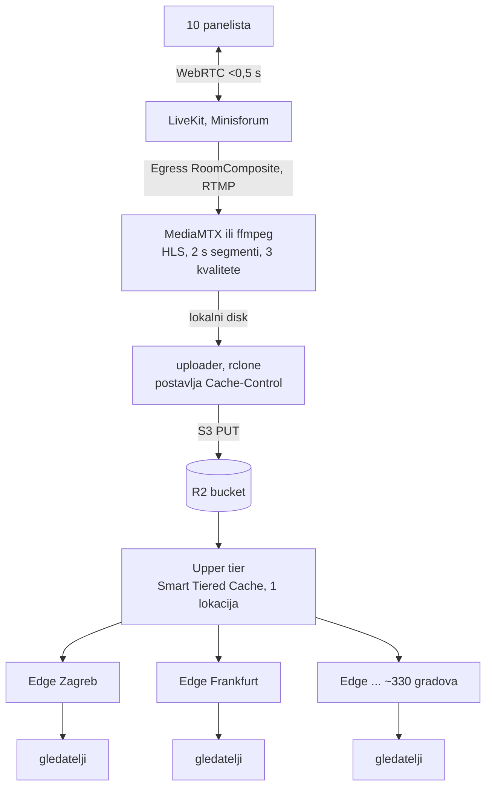

# Istraživanje: panel na lokalnom LiveKitu, milijun gledatelja kroz Cloudflare

Datum: 2026-10-26. Izvor: Cloudflare dokumentacija i uvjeti korištenja (provjereno
na dan pisanja), ostalo iz poznavanja HLS-a i LiveKita. Brojke operacija su
**izračun, ne mjerenje**.

## Zaključak

- Panel od ~10 ljudi ostaje na lokalnom LiveKitu (WebRTC, <0,5 s među njima).
- Gledatelji dobivaju HLS iz **R2 kroz Cloudflare edge cache**. Kašnjenje
  gledatelja je 4–10 s; realtime za milijun ljudi kroz cache ne postoji.
- Trošak ne ovisi o broju gledatelja: Minisforum šalje jedan stream, R2 egress
  je besplatan, a R2 operacije ovise o broju **objekata**, ne gledatelja.
- Uz Smart Tiered Cache R2 vidi otprilike **jedan** dohvat po objektu, ne jedan
  po Cloudflare lokaciji. Oko 16.000 Class B operacija na sat prijenosa,
  bez obzira gleda li 100 ili 1.000.000 ljudi.

## Zašto YouTube može, a lokalni server ne

YouTube stream kodira jednom (više kvaliteta), reže na HLS/DASH segmente od
2–6 s i poslužuje **iste datoteke** svima, preko desetaka tisuća edge servera
(dio unutar ISP-ova, Google Global Cache). Milijun × ~3 Mbit/s ≈ 3 Tbit/s,
što ne izgura nijedan pojedinačni stroj.

WebRTC (LiveKit, Meet) svakom sudioniku šalje zaseban stream bez cachea. Zato
skalira s uplinkom SFU-a, a ne s CDN-om. I Google Meet za velike skupine prelazi
u „live stream" način, tj. YouTube model.

| | HLS kroz CDN | WebRTC (SFU) |
|---|---|---|
| Kašnjenje | 4–30 s | < 0,5 s |
| Po gledatelju | ista datoteka, cache | poseban paket |
| Skaliranje | CDN | uplink SFU-a |

## Uvjeti korištenja: što smije na Free planu

Cloudflare Service-Specific Terms, odjeljak CDN: bez Enterprise ugovora video i
velike datoteke kroz CDN smiju se posluživati **samo preko plaćenih usluga**
(Developer Platform, Images, Stream).

- Minisforum iza Cloudflare Tunnela s cacheiranim videom na Free planu: **krši
  uvjete**.
- Video u **R2** (Developer Platform) s custom domenom: dopušteno.
- Cloudflare Stream: dopušteno, ali naplata po minuti gledanja (linearno).

## Arhitektura

- LiveKit Egress u HLS daje samo jednu kvalitetu, zato ide RTMP na lokalni
  transcoder koji radi više kvaliteta.
- Uploader je zaseban korak jer svaki objekt mora dobiti vlastiti
  `Cache-Control` (vidi niže). Za izravni S3 upload iz Egressa nije provjereno
  može li postaviti taj header.
- Egress podržava više izlaza: isti miks može ići i na YouTube kao rezervu.

## Kako R2 operacije ne rastu s brojem gledatelja

Bez cachea rast je **linearan** (gledatelji × zahtjevi po gledatelju), ne
eksponencijalan. Ali s milijun gledatelja i zahtjevom svake 2 s to je ogromno.
Cilj je da R2 vidi samo zahtjeve Cloudflareovih servera, a nikad gledatelja.

### Tri razine, tko koga pita

1. **Gledatelj → edge lokacija** (najbliži grad). HIT: R2 se ne dira.
2. **Edge → upper tier.** S uključenim Smart Tiered Cacheom edge na MISS ne ide
   u R2 nego na jednu upper-tier lokaciju koju Cloudflare bira uz bucket.
   R2 dokumentacija to izričito preporučuje.
3. **Upper tier → R2.** Samo ovdje nastaje Class B operacija.

Zato granica nije „~330 operacija po objektu" (po jedna za svaku lokaciju),
nego otprilike **1 po objektu po isteku TTL-a**. Tih ~330 vrijedi samo ako
Tiered Cache nije uključen.

### Izračun (3 kvalitete, 2 s segmenti)

| Objekt | TTL | Dohvata iz R2 na sat |
|---|---|---|
| segmenti (.ts/.m4s) | dan, immutable | 3 × 1.800 = 5.400 |
| playliste kvaliteta (.m3u8) | 1 s | 3 × 3.600 = 10.800 |
| master playlista | 60 s | 60 |
| **ukupno** | | **~16.000** |

Uz rezervu za izbacivanje iz cachea i fallback upper tier, računaj ~30.000 na
sat. Besplatno je 10 M Class B mjesečno, dakle **stotine sati prijenosa
mjesečno besplatno**. Iznad toga $0,36 / M, oko $0,01 na sat.

Usporedba istog sata s 1 M gledatelja:

| Postavka | Class B / sat | Trošak / sat |
|---|---|---|
| custom domena + Smart Tiered Cache | ~16–30 tisuća | ~$0 |
| custom domena, bez Tiered Cachea | ~5 M (× broj lokacija) | ~$2 |
| bez cachea (r2.dev ili bypass) | ~3,6 milijarde | ~$1.300 |

Upisi (Class A): segmenti i playliste ≈ 16.000 PUT-ova na sat. Besplatno je
1 M mjesečno, dakle oko 60 sati prijenosa mjesečno; iznad toga $4,50 / M, oko
$0,07 na sat. Ni to ne ovisi o gledateljima.

### Popis uvjeta (svaki je obavezan)

1. **Custom domena na bucketu**, npr. `live.example.hr`. `r2.dev` nema cache i
   ograničen je brzinom.
2. **Smart Tiered Cache uključen** (Caching → Tiered Cache; dostupno na Free).
3. **Cache Rule** za taj hostname: *Eligible for cache*, Edge TTL „koristi
   Cache-Control iz odgovora". Bez toga Cloudflare cacheira samo zadane
   ekstenzije, a R2 dokumentacija traži „Cache Everything". Free plan ne može
   pravilom postaviti edge TTL ispod 2 h, zato TTL mora doći iz objekta.
4. **Cache-Control kao metapodatak svakog objekta** (uploader ga postavlja):
   - segmenti: `public, max-age=86400, immutable`
   - playliste kvaliteta: `public, max-age=1`
   - master playlista: `public, max-age=60`
5. **Segmenti se nikad ne prepisuju.** Svaki ima jedinstveno ime (redni broj),
   samo playlista zadržava isto ime.
6. **Nikakav query string.** Svaki drugačiji `?x=` je novi ključ u cacheu i
   novi dohvat iz R2. WAF custom rule: blokiraj zahtjeve na taj hostname s
   nepraznim `http.request.uri.query`.
7. **Bez tokena, kolačića i `Authorization` na segmentima.** Potpisani URL-ovi
   po gledatelju razbijaju cache. Ako treba zaštita, ona ide na stranicu s
   playerom, ne na segmente.
8. **Zaštita od izmišljenih putanja.** GET na nepostojeći objekt je također
   Class B operacija, a napadač može generirati beskonačno imena. WAF rule
   propušta samo putanje pod `/live/` s ekstenzijom `.m3u8`, `.ts` ili `.m4s`,
   a rate limiting rule (Free ima jedno) ograničava pojedinu IP adresu.
9. **Bez Workera na putu.** Workers se naplaćuju po zahtjevu, pa bi trošak opet
   rastao s gledateljima.
10. **Playlistu nikad na „bypass cache"**, to je zadnji red usporedne tablice.

### Kako provjeriti

- `curl -sI https://live.example.hr/live/720p.m3u8 | grep -i cf-cache-status`:
  drugi poziv unutar sekunde mora biti `HIT`, segmenti uvijek `HIT` nakon prvog.
- R2 dashboard → Metrics: broj Class B operacija tijekom testnog prijenosa mora
  ostati ravan dok broj gledatelja raste.
- R2 nema tvrdi limit troška; postavi billing notification u Cloudflare računu.

## Realnost na skali od milijun

- **Video**: 1 M × 2,5 Mbit/s ≈ 1 PB na sat. Uvjeti to dopuštaju i R2 egress je
  besplatan, ali na toj razini očekuj da Cloudflare traži Enterprise ugovor.
  Za stotine i desetke tisuća gledatelja praktički je besplatno.
- **Samo zvuk** (molitva): 1 M × 32 kbit/s ≈ 14 TB na sat, za Cloudflare
  zanemarivo.
- **Kašnjenje**: klasični HLS s 1–2 s segmentima daje 4–10 s. LL-HLS traži
  blokirajuće zahtjeve za playlistu, a R2 ih ne podržava.

## Gotove alternative

| Opcija | 1 M gledatelja × 1 h | Kašnjenje |
|---|---|---|
| YouTube Live (Egress → RTMP) | $0 | 2–5 s |
| R2 + edge cache (ovaj dokument) | ~$0 do razgovora s Cloudflareom | 4–10 s |
| Cloudflare Stream Live | $1 / 1.000 min → ~$60.000 | HLS ili WebRTC |
| Cloudflare Realtime SFU za gledatelje | $0,05 / GB → linearno | < 1 s |

Za jedno veliko događanje najjeftinije je slati istovremeno na YouTube i u R2.

## Otvoreno

- Izmjeriti CPU Minisforuma za LiveKit + Egress (Chrome) + transcoding u 3
  kvalitete istovremeno.
- Provjeriti može li LiveKit Egress S3 upload postaviti `Cache-Control`; ako
  može, uploader nije potreban.
- Testni prijenos s nekoliko stotina gledatelja (npr. k6 ili `hls-load-test`)
  i mjerenje Class B operacija.

## Izvori

- [Cloudflare Service-Specific Terms (CDN, video)](https://www.cloudflare.com/service-specific-terms-application-services/)
- [R2 public buckets (custom domena, cache, Smart Tiered Cache)](https://developers.cloudflare.com/r2/buckets/public-buckets/)
- [Tiered Cache (Smart Topology na Free planu)](https://developers.cloudflare.com/cache/how-to/tiered-cache/)
- [Cache plans (minimalni edge TTL po planu)](https://developers.cloudflare.com/cache/plans/)
- [Edge i Browser Cache TTL](https://developers.cloudflare.com/cache/how-to/edge-browser-cache-ttl/)
- [Cloudflare Stream pricing](https://developers.cloudflare.com/stream/pricing)
