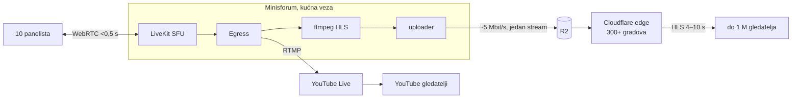
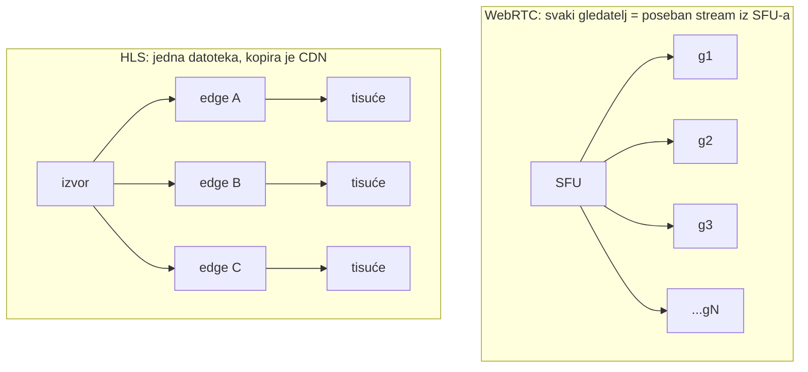
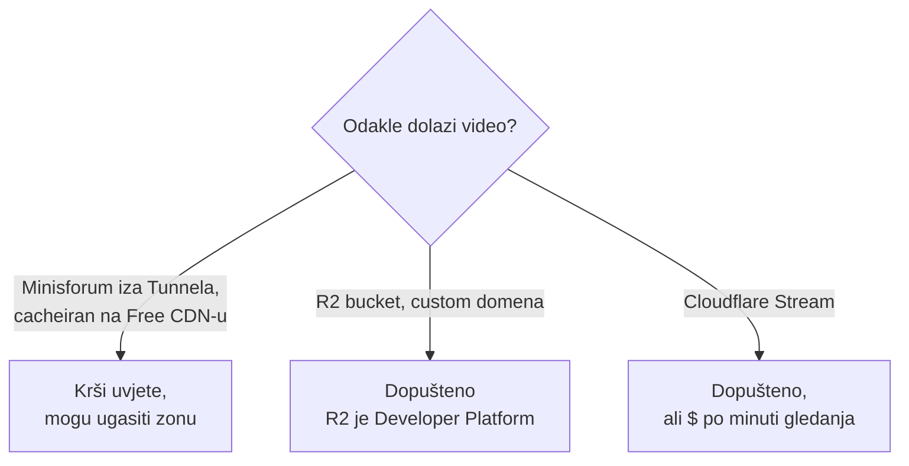

# Istraživanje: panel na lokalnom LiveKitu, milijun gledatelja kroz Cloudflare

Datum: 2026-10-26. Izvor: Cloudflare i LiveKit dokumentacija te Cloudflare
uvjeti korištenja (provjereno na dan pisanja), ostalo iz poznavanja HLS-a.
Brojke operacija i troškova su **izračun, ne mjerenje**.

Nastavak:

- [R2 operacije i cache](2026-10-26-r2-operacije-i-cache.md): zašto R2 vidi
  ~1 dohvat po objektu, a ne po gledatelju, i što to može pokvariti.
- [HLS pipeline: implementacija](2026-10-26-hls-pipeline-implementacija.md):
  Egress, ffmpeg, uploader, Cloudflare postavke i plan testiranja.

## Zaključak

- Panel od ~10 ljudi ostaje na lokalnom LiveKitu (WebRTC, <0,5 s među njima).
- Gledatelji dobivaju HLS iz **R2 kroz Cloudflare edge cache**. Kašnjenje
  gledatelja je 4–10 s; realtime za milijun ljudi kroz cache ne postoji.
- Trošak ne ovisi o broju gledatelja: Minisforum šalje jedan stream (~5 Mbit/s),
  R2 egress je besplatan, a R2 operacije ovise o broju **objekata**, ne gledatelja.
- Uz Smart Tiered Cache R2 vidi otprilike **jedan** dohvat po objektu. Oko
  16.000 Class B operacija na sat prijenosa, bez obzira gleda li 100 ili
  1.000.000 ljudi. Besplatno je 10 M mjesečno.
- Isti miks istovremeno ide na YouTube kao rezerva (jedan Egress, više izlaza).

## Zašto YouTube može, a lokalni server ne

YouTube stream kodira jednom (više kvaliteta), reže na HLS/DASH segmente od
2–6 s i poslužuje **iste datoteke** svima, preko desetaka tisuća edge servera
(dio unutar ISP-ova, Google Global Cache). Milijun × ~3 Mbit/s ≈ 3 Tbit/s,
što ne izgura nijedan pojedinačni stroj.

WebRTC (LiveKit, Meet) svakom sudioniku šalje zaseban stream bez cachea. Zato
skalira s uplinkom SFU-a, a ne s CDN-om. I Google Meet za velike skupine prelazi
u „live stream" način, tj. YouTube model.

| | HLS kroz CDN | WebRTC (SFU) |
|---|---|---|
| Kašnjenje | 4–30 s | < 0,5 s |
| Smjer | jedan → mnogo | svi ↔ svi |
| Po gledatelju | ista datoteka, cache | poseban paket |
| Skaliranje | CDN | uplink SFU-a |

## Uvjeti korištenja: što smije na Free planu

Cloudflare Service-Specific Terms, odjeljak CDN: bez Enterprise ugovora video i
velike datoteke kroz CDN smiju se posluživati **samo preko plaćenih usluga**
(Developer Platform, Images, Stream).

## Proračun kašnjenja gledatelja

| Korak | 2 s segmenti | 1 s segmenti |
|---|---:|---:|
| Egress (Chrome kompozit) → RTMP | ~0,5–1 s | ~0,5–1 s |
| ffmpeg kodiranje | ~0,3 s | ~0,3 s |
| segment se mora dovršiti | 2 s | 1 s |
| upload u R2 | ~0,2 s | ~0,2 s |
| TTL playliste (+ stale-while-revalidate) | do 1–2 s | do 1–2 s |
| buffer playera (hls.js: 3 segmenta, može 2) | 4–6 s | 2–3 s |
| **ukupno** | **~8–10 s** | **~4–6 s** |

LL-HLS (dijelovi segmenata) bi spustio na 2–3 s, ali traži blokirajuće zahtjeve
za playlistu (`_HLS_msn`), koje poslužitelj drži otvorenima dok novi dio ne
nastane. R2 to ne radi, a svaki drugačiji query string je novi ključ u cacheu.

## Trošak po broju gledatelja

| Gledatelji (1 h, 720p ~2,5 Mbit/s) | Promet s edgea | R2 Class B | Trošak |
|---:|---:|---:|---|
| 100 | ~110 GB | ~16 tis. | $0 |
| 10.000 | ~11 TB | ~16 tis. | $0 |
| 100.000 | ~110 TB | ~16 tis. | $0 |
| 1.000.000 | ~1,1 PB | ~16 tis. | $0 po cjeniku |

Promet raste linearno, ali Cloudflare ga ne naplaćuje (R2 egress je besplatan).
R2 operacije ostaju ravne. Detalji u [R2 operacije i cache](2026-10-26-r2-operacije-i-cache.md).

Realnost na vrhu tablice:

- **Video**: 1 PB na sat je dopušten po uvjetima, ali na toj razini očekuj da
  Cloudflare traži Enterprise ugovor. Za stotine i desetke tisuća gledatelja
  praktički je besplatno.
- **Samo zvuk** (molitva): 1 M × 32 kbit/s ≈ 14 TB na sat, za Cloudflare
  zanemarivo.

## Gotove alternative

| Opcija | 1 M gledatelja × 1 h | Kašnjenje | Skalira |
|---|---|---|---|
| YouTube Live (Egress → RTMP) | $0 | 2–5 s (ultra low latency) | ne s nama |
| R2 + edge cache (ovaj plan) | ~$0 do razgovora s Cloudflareom | 4–10 s | ne s gledateljima |
| Cloudflare Stream Live | $1 / 1.000 min → ~$60.000 | HLS ili WebRTC | linearno |
| Cloudflare Realtime SFU za gledatelje | $0,05 / GB → desetci tisuća $ | < 1 s | linearno |

Za jedno veliko događanje najjeftinije je slati istovremeno na YouTube i u R2.
YouTube nosi masu, R2 služi vlastiti player bez reklama i bez Googlea.

## Otpornost

Kućna veza i struja su jedna točka kvara (vidi kapacitet u
[istraživanju od 25.10.](2026-10-25-istrazivanje-platformi-i-video-tehnologije.md)).
Kad Minisforum padne, playlista se prestane osvježavati i gledatelji stanu.
YouTube izlaz pada zajedno s njim, jer ga šalje isti Egress. Za važna događanja
treba UPS i drugu vezu (npr. LTE ruter kao failover).

## GDPR

- Panelisti: javni prijenos njihovog lica i glasa traži privolu. Ako je sadržaj
  vjerski, to je podatak iz čl. 9.
- Gledatelji: segmenti su anonimni, ali Cloudflare vidi IP adrese. To ide u
  politiku privatnosti stranice s playerom.

## Izvori

- [Cloudflare Service-Specific Terms (CDN, video)](https://www.cloudflare.com/service-specific-terms-application-services/)
- [R2 public buckets](https://developers.cloudflare.com/r2/buckets/public-buckets/)
- [R2 pricing](https://developers.cloudflare.com/r2/pricing/)
- [Cloudflare Stream pricing](https://developers.cloudflare.com/stream/pricing)
- [LiveKit Egress outputs](https://docs.livekit.io/transport/media/ingress-egress/egress/outputs/)
