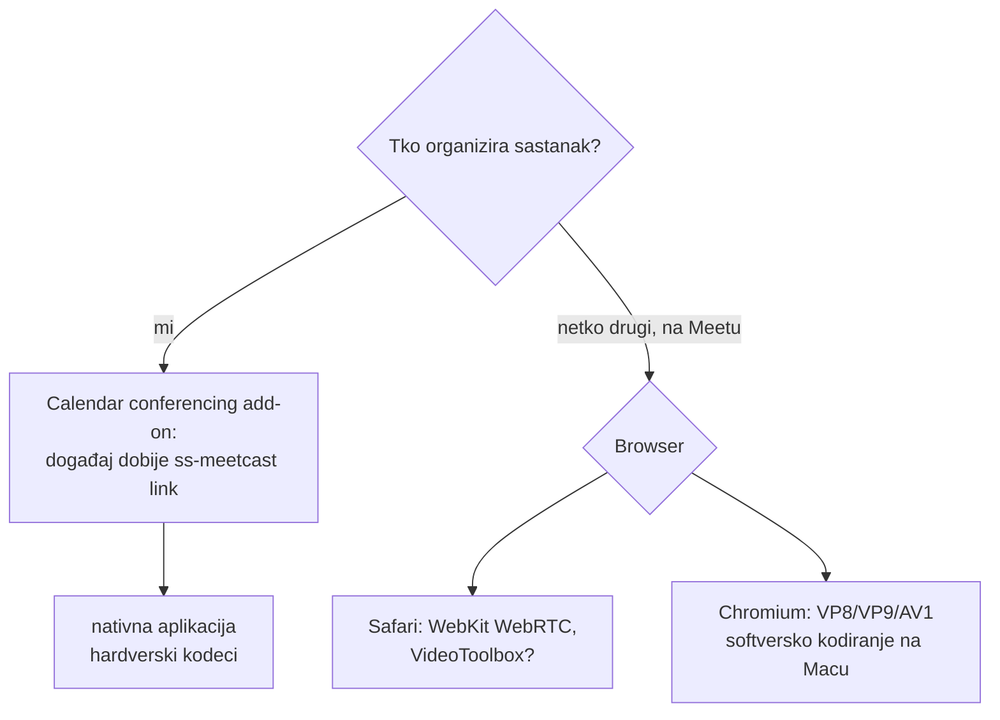
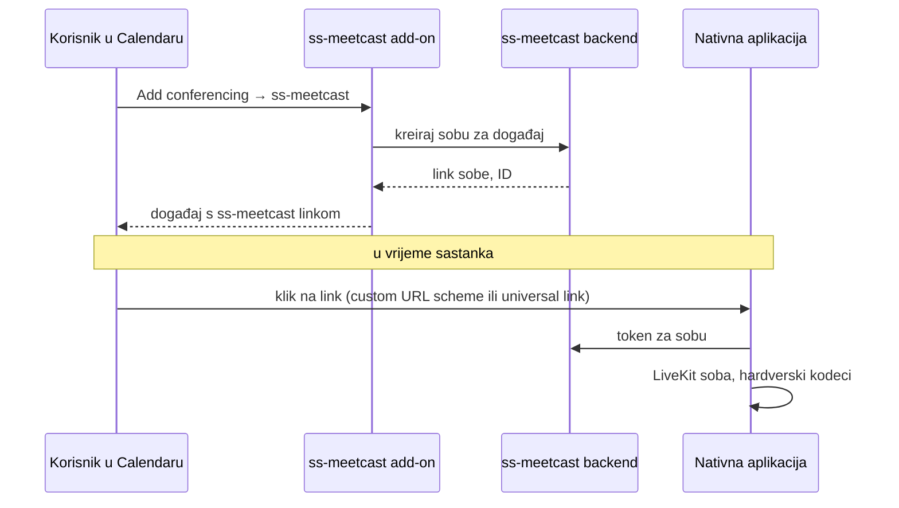

# Integracija s Google Meetom i Google Calendarom

Datum: 2026-10-26. Pitanje: može li vlastita nativna aplikacija (vidi
[viziju u 4K panelu](2026-10-26-4k-panel.md#vizija-nativne-aplikacije-za-macos-i-windows))
otvoriti Meet sastanak iz kalendara i spojiti se na standardni Google Meet,
ali s hardverskim kodecima?

## Zaključak

- **Ne postoji službeni način** da vlastiti klijent uđe u Meet kao punopravni
  sudionik (šalje kameru i zvuk).
- Na GitHubu nema održavanog nativnog Meet klijenta; postoje samo omotači oko
  web klijenta (Electron, Puppeteer botovi), koji koriste isti Chromium.
- Realan put je obrnut: **ss-meetcast kao pružatelj videokonferencija u Google
  Calendaru**, za sastanke koje organiziramo mi.
- Za tuđe Meet sastanke ostaje browser; vrijedi izmjeriti je li Safari na Macu
  štedljiviji od Chromiuma (test niže).

## Mogući putovi u Meet

| Put | Što omogućuje | Zašto ne rješava problem |
|---|---|---|
| **Meet Media API** (službeni) | aplikacija **prima** audio, video i metapodatke uživo | samo primanje; Developer Preview koji **više ne prima nove prijave**; treba privolu nekoga iz organizacije domaćina (za @gmail.com sastanke inicijator mora biti u pozivu); ne radi sa šifriranim sastancima ni s vodenim žigom; bilo tko ga može isključiti tijekom poziva |
| **SIP/H.323 kroz Pexip** (Pexip Connect for Google Meet) | standardni SIP klijent ili sobni sustav ulazi u Meet | posebna Pexip pretplata i Workspace admin (interoperability token); gateway transkodira, što dodaje kašnjenje i ograničava kvalitetu |
| **Reverse-engineering** Meet protokola | pravi nativni klijent | krši Googleove uvjete, puca pri svakoj promjeni, nitko ga javno ne održava |
| **Electron omotači, Puppeteer botovi** | Meet u vlastitom prozoru ili automatizacija | isti Chromium, isti kodeci |
| **Meet Add-ons SDK** | vlastita aplikacija unutar Meet sučelja | ne mijenja video put ni kodeke |

Od 6. 7. 2026. Google podržava i obrnuti smjer: Meet sobni hardver ulazi u
tuđe SIP sastanke kroz Pexip. Ni to ne daje vlastitom klijentu ulaz u Meet.

## ss-meetcast kao pružatelj konferencija u Calendaru

Google Workspace Add-ons za Calendar dopuštaju **vlastito rješenje za
konferencije** u izborniku „Add conferencing" (kao Zoom). Događaj tada umjesto
Meet linka dobije naš link i podatke za spajanje.

Treba provjeriti prije izrade: točan oblik conferencing add-ona (Apps Script
`ConferenceDataService` ili Workspace Add-on manifest), objavu u Marketplaceu
za korisnike izvan naše domene i otvaranje linka u nativnoj aplikaciji
(universal link na macOS-u traži vlastitu domenu, rezerva je web stranica koja
pokreće `ss-meetcast://`).

## Test: Google Meet u Safariju protiv Bravea

Hipoteza: Safari ima vlastiti WebRTC (WebKit) s VideoToolboxom, pa Meet u
Safariju možda šalje H.264 hardverski i troši manje CPU-a nego u Braveu, gdje
kodira VP8/VP9 softverski. Nije potvrđeno.

Postupak:

1. Mac mini: Safari → `meet.new`, kamera uključena, efekti isključeni.
2. iPhone: ulazi u isti sastanak (drugi sudionik).
3. CPU Safari procesa (`Safari`, `com.apple.WebKit.WebContent`,
   `com.apple.WebKit.GPU`) mjeri se 30 s preko `top`.
4. Isto ponoviti u Braveu; u `brave://webrtc-internals` zapisati
   `encoderImplementation` i kodek.
5. Opcionalno: dijeljenje ekrana u oba browsera.

Rezultati: *(upisuju se nakon testa)*

## Izvori

- [Google Meet Media API overview](https://developers.google.com/workspace/meet/media-api/guides/overview)
- [Allow 3rd party devices to join Meet video meetings](https://support.google.com/a/answer/7673980)
- [Workspace Updates: Meet hardware via SIP through Pexip (2026-07-06)](https://workspaceupdates.googleblog.com/2026/07/join-video-conferences-on-google-meet-hardware-via-SIP-through-Pexip.html)
- [GitHub topic: meet](https://www.GitHub.com/topics/meet)
