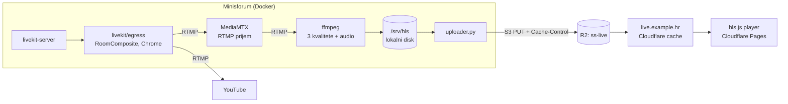
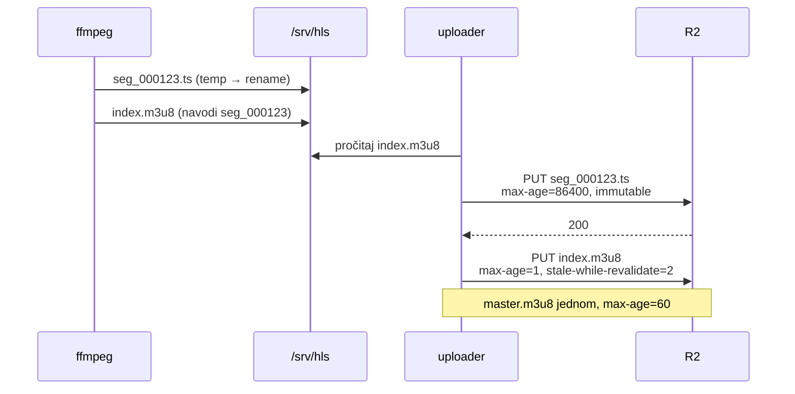
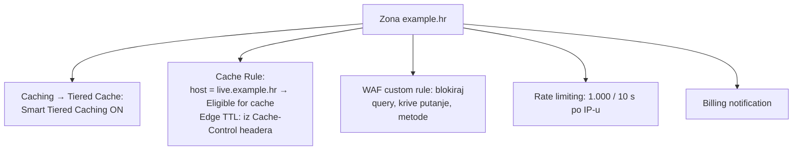
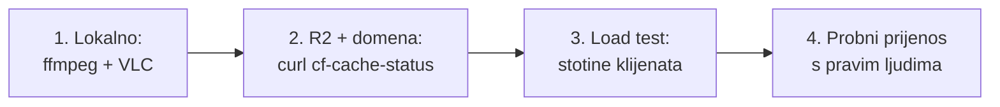

# HLS pipeline: od LiveKit sobe do Cloudflare edgea

Datum: 2026-10-26. Dio istraživanja
[distribucije kroz Cloudflare edge](2026-10-26-distribucija-kroz-cloudflare-edge.md).
Naredbe i kod su **skice, nisu pokrenuti**. Imena (`panel`,
`live.example.hr`, `ss-live`) su primjeri.

## Komponente



Zašto ovako, a ne izravno Egress → R2:

- Egress HLS izlaz daje **jednu kvalitetu**. Za 1 M gledatelja na raznim
  vezama treba ladder (1080p/720p/480p i samo zvuk), a to radi ffmpeg.
- Egress S3 izlaz ima `metadata` (S3 korisnički metapodaci, `x-amz-meta-*`) i
  `content_disposition`, ali ne `Cache-Control`. Bez `Cache-Control` playlista
  bi na edgeu stajala 2 h. Zato uploader.
- MediaMTX samo prima i prosljeđuje RTMP (ne transkodira). Služi kao stabilna
  točka između Egressa i ffmpega, da restart ffmpega ne sruši Egress.

## 1. Egress: jedan kompozit, dva izlaza

Egress kodira jednom i šalje na više RTMP adresa:

```json
{
  "room_name": "panel",
  "layout": "speaker",
  "preset": "H264_1080P_30",
  "stream_outputs": [
    {
      "protocol": "RTMP",
      "urls": [
        "rtmp://mediamtx:1935/live/panel",
        "rtmp://a.rtmp.youtube.com/live2/<YOUTUBE_KLJUC>"
      ]
    }
  ]
}
```

```bash
lk egress start --type room-composite egress.json
```

Egress kompozit troši 2–6 CPU i ~4 GB RAM-a (vidi kapacitet u
[istraživanju od 25.10.](2026-10-25-istrazivanje-platformi-i-video-tehnologije.md#kapacitet-lokalnog-servera-minisforum-bez-clouda)).

## 2. ffmpeg: ladder u HLS

```bash
ffmpeg -i rtmp://mediamtx:1935/live/panel \
  -filter_complex "[0:v]split=3[a][b][c];[a]scale=-2:1080[v0];[b]scale=-2:720[v1];[c]scale=-2:480[v2]" \
  -map "[v0]" -map "[v1]" -map "[v2]" -map 0:a -map 0:a -map 0:a -map 0:a \
  -c:v libx264 -preset veryfast -tune zerolatency \
  -g 60 -keyint_min 60 -sc_threshold 0 \
  -b:v:0 4500k -maxrate:v:0 4800k -bufsize:v:0 9000k \
  -b:v:1 2500k -maxrate:v:1 2700k -bufsize:v:1 5000k \
  -b:v:2 1000k -maxrate:v:2 1100k -bufsize:v:2 2000k \
  -c:a aac -b:a 128k -ac 2 \
  -f hls -hls_time 2 -hls_list_size 6 \
  -hls_flags independent_segments+delete_segments+temp_file \
  -master_pl_name master.m3u8 \
  -var_stream_map "v:0,a:0,name:1080p v:1,a:1,name:720p v:2,a:2,name:480p a:3,name:audio" \
  -hls_segment_filename "/srv/hls/%v/seg_%06d.ts" \
  /srv/hls/%v/index.m3u8
```

- `-g 60` uz 30 fps znači ključni kadar svake 2 s, poravnat sa segmentom.
- `temp_file`: ffmpeg piše u privremenu datoteku i preimenuje je kad je gotova,
  pa uploader nikad ne pošalje pola segmenta.
- `delete_segments` briše stare segmente s lokalnog diska. U R2 ih briše
  lifecycle pravilo (korak 4).
- Kvaliteta „samo zvuk" (~128 kbit/s) je za slabe veze i za molitvu bez slike.

CPU: tri x264 kodiranja `veryfast` (1080p + 720p + 480p) traže otprilike 3–4
jezgre uz Egress. To treba izmjeriti na Minisforumu.

## 3. Uploader: redoslijed je bitan

Playlista se smije poslati **tek kad su svi segmenti koje navodi već u R2**.
Inače edge cacheira playlistu koja pokazuje na nepostojeći segment, a 404 se
cacheira 3 minute.



Skica (Python, `boto3`):

```python
import time, pathlib, boto3

ROOT = pathlib.Path("/srv/hls")
s3 = boto3.client("s3", endpoint_url="https://<ACCOUNT_ID>.r2.cloudflarestorage.com")
BUCKET = "ss-live"
SEG = {"CacheControl": "public, max-age=86400, immutable", "ContentType": "video/mp2t"}
LIST = {"CacheControl": "public, max-age=1, stale-while-revalidate=2",
        "ContentType": "application/vnd.apple.mpegurl"}
MASTER = {"CacheControl": "public, max-age=60", "ContentType": "application/vnd.apple.mpegurl"}

uploaded, last_playlist = set(), {}

def put(path, extra):
    key = "live/" + path.relative_to(ROOT).as_posix()
    s3.put_object(Bucket=BUCKET, Key=key, Body=path.read_bytes(), **extra)

while True:
    master = ROOT / "master.m3u8"
    if master.exists() and "master" not in uploaded:
        put(master, MASTER)
        uploaded.add("master")
    for playlist in ROOT.glob("*/index.m3u8"):
        text = playlist.read_text()
        if last_playlist.get(playlist) == text:
            continue
        for line in text.splitlines():
            if line.endswith(".ts"):
                seg = playlist.parent / line
                if seg not in uploaded:
                    put(seg, SEG)
                    uploaded.add(seg)
        put(playlist, LIST)
        last_playlist[playlist] = text
    time.sleep(0.25)
```

Za produkciju još treba: ponovni pokušaj na grešku mreže, čišćenje skupa
`uploaded` i paralelni upload kvaliteta. Upload je ~5 Mbit/s, kućna veza to
podnosi bez problema.

## 4. R2 bucket

| Postavka | Vrijednost | Zašto |
|---|---|---|
| Custom domena | `live.example.hr` (zona na Cloudflareu) | `r2.dev` nema cache i ograničen je brzinom |
| `r2.dev` pristup | isključen | da nitko ne zaobiđe cache |
| Lifecycle | briši `live/` nakon 1 dana | segmenti su potrebni samo uživo |
| CORS | `AllowedOrigins: ["*"]`, `GET`, `HEAD` | hls.js na drugoj domeni; `*` je isti za sve, pa ne razbija cache |

```json
[
  {
    "AllowedOrigins": ["*"],
    "AllowedMethods": ["GET", "HEAD"],
    "AllowedHeaders": ["*"],
    "MaxAgeSeconds": 86400
  }
]
```

CORS s jednom fiksnom ili `*` vrijednošću je bitan: Cloudflare cache ne
razlikuje odgovore po `Origin` headeru, pa bi odgovor s jednom dopuštenom
domenom bio poslužen svima.

## 5. Cloudflare zona



**Cache Rule** (Caching → Cache Rules):

```
(http.host eq "live.example.hr")
→ Cache eligibility: Eligible for cache
→ Edge TTL: Use cache-control header if present
→ Browser TTL: Respect origin
```

**WAF custom rule** (Security → WAF → Custom rules, Free ima 5 pravila,
bez regexa). Akcija Block:

```
(http.host eq "live.example.hr") and (
  http.request.uri.query ne ""
  or not http.request.method in {"GET" "HEAD"}
  or not starts_with(http.request.uri.path, "/live/")
  or not (ends_with(http.request.uri.path, ".m3u8")
          or ends_with(http.request.uri.path, ".ts"))
)
```

Dostupnost `starts_with` i `ends_with` na Free planu nije potvrđena u
dokumentaciji; provjeriti u editoru pravila. Rezerva je `wildcard` operator
ili samo provjera query stringa i metode.

**Rate limiting** (jedno pravilo na Free, 10 s, po IP-u): prag visok zbog
CGNAT-a, vidi [R2 operacije](2026-10-26-r2-operacije-i-cache.md#napadi-na-račun-cost-attack).

## 6. Player

Stranica s playerom na Cloudflare Pages (besplatno, statički HTML):

```html
<video id="v" controls autoplay muted playsinline></video>
<script src="https://cdn.jsdelivr.net/npm/hls.js@1.5.17"></script>
<script>
  const src = "https://live.example.hr/live/master.m3u8";
  const v = document.getElementById("v");
  if (v.canPlayType("application/vnd.apple.mpegurl")) {
    v.src = src; // Safari i iOS imaju HLS ugrađen
  } else {
    const hls = new Hls({ liveSyncDurationCount: 2 });
    hls.loadSource(src);
    hls.attachMedia(v);
  }
</script>
```

`liveSyncDurationCount: 2` drži player 2 segmenta iza ruba (zadano je 3):
manje kašnjenja, ali osjetljivije na trzaje mreže.

## Plan testiranja



1. **Lokalno.** Egress → MediaMTX → ffmpeg, gledati `/srv/hls/master.m3u8` u
   VLC-u. Izmjeriti CPU i RAM Minisforuma s LiveKitom, Egressom i ffmpegom.
2. **Cache.** Za vrijeme prijenosa:
   ```bash
   for i in 1 2 3; do
     curl -sI https://live.example.hr/live/720p/index.m3u8 | grep -iE "cf-cache-status|age|cache-control"
     sleep 0.3
   done
   ```
   Playlista: `MISS` ili `EXPIRED` pa `HIT` unutar sekunde. Segmenti: `HIT`
   nakon prvog dohvata. Zahtjev s `?x=1` mora dobiti 403 od WAF-a.
3. **Load test.** Nekoliko stotina HLS klijenata s više strojeva i lokacija
   (npr. k6 skripta koja dohvaća playlistu i segmente). U R2 → Metrics broj
   Class B operacija mora ostati ravan dok broj klijenata raste. To potvrđuje
   ili ruši [izračun](2026-10-26-r2-operacije-i-cache.md#izračun-operacija-na-sat-3-kvalitete-2-s-segmenti).
4. **Probni prijenos** jednog panela uz YouTube kao rezervu.

## Izvori

- [LiveKit Egress outputs (segmenti, S3 polja, više RTMP adresa)](https://docs.livekit.io/transport/media/ingress-egress/egress/outputs/)
- [R2 public buckets](https://developers.cloudflare.com/r2/buckets/public-buckets/)
- [Default cache behavior](https://developers.cloudflare.com/cache/concepts/default-cache-behavior/)
- [Cache-Control na Cloudflareu](https://developers.cloudflare.com/cache/concepts/cache-control/)
- [WAF custom rules](https://developers.cloudflare.com/waf/custom-rules/)
- [Rate limiting rules](https://developers.cloudflare.com/waf/rate-limiting-rules/)
