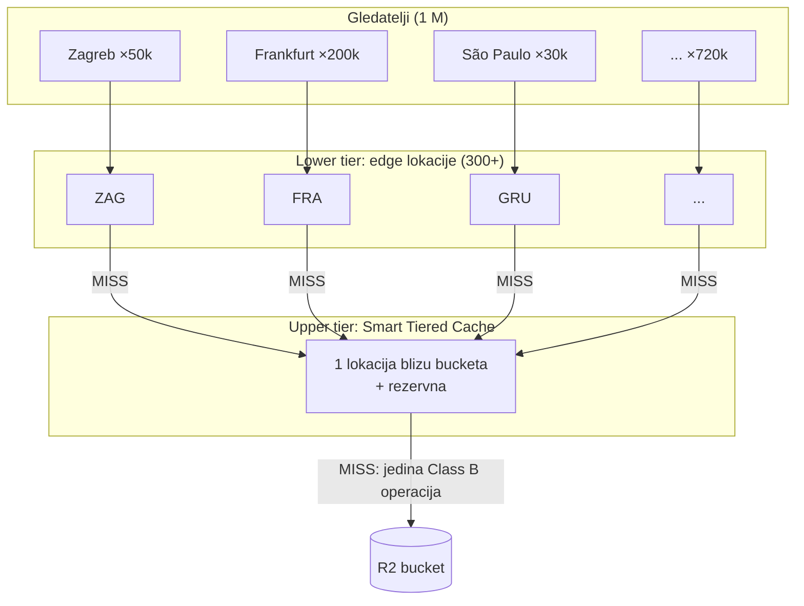
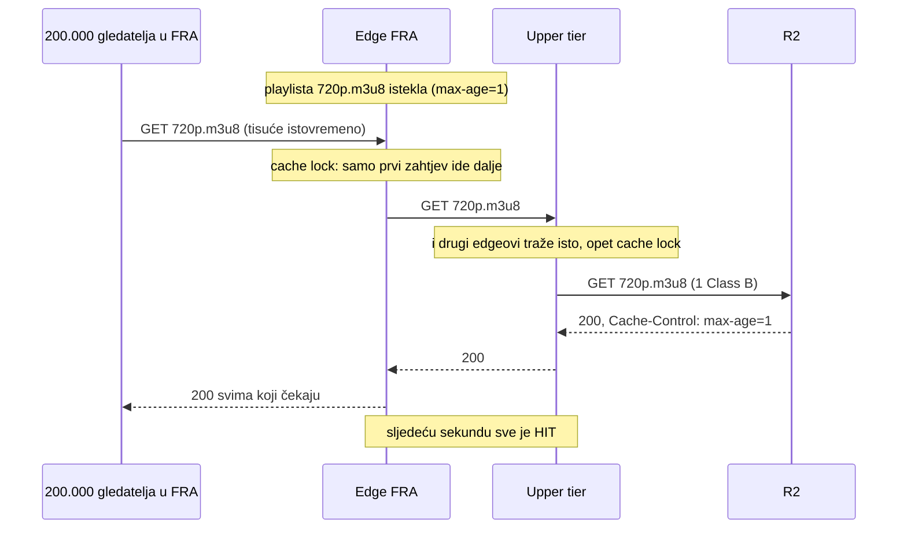
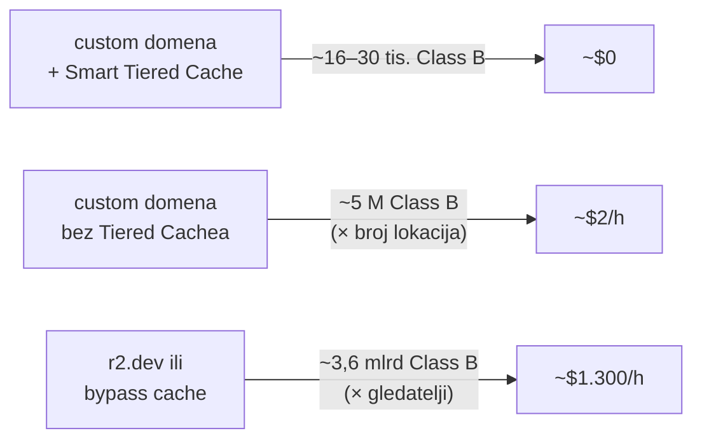
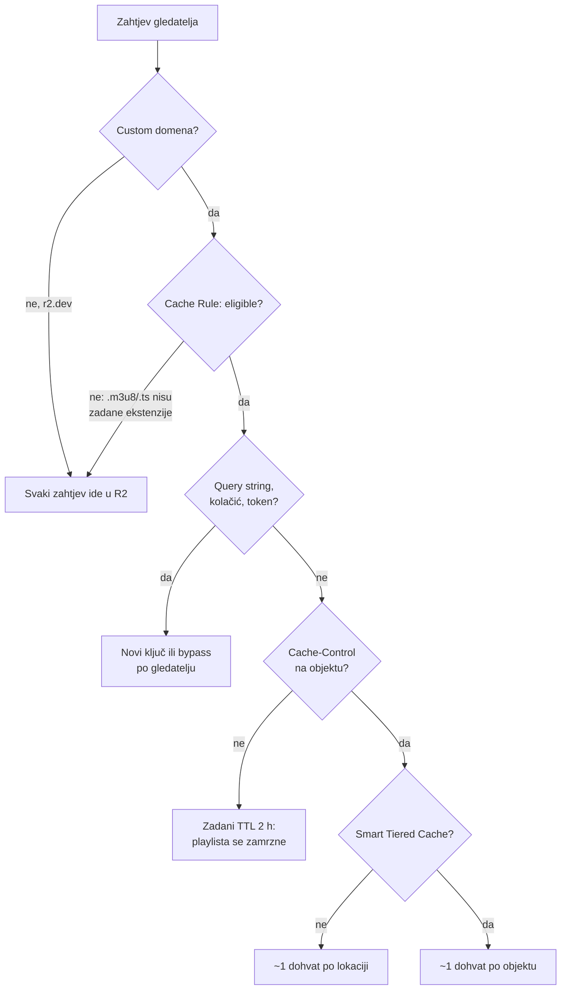

# R2 operacije i Cloudflare cache: zašto ne rastu s brojem gledatelja

Datum: 2026-10-26. Dio istraživanja
[distribucije kroz Cloudflare edge](2026-10-26-distribucija-kroz-cloudflare-edge.md).
Brojke su izračun; mjerenje je u planu testiranja u
[implementaciji](2026-10-26-hls-pipeline-implementacija.md#plan-testiranja).

## Zaključak

- Bez cachea rast je **linearan**, ne eksponencijalan: gledatelji × zahtjevi po
  gledatelju. Kod milijun gledatelja to je ~3,6 milijardi zahtjeva na sat.
- S cacheom R2 vidi samo Cloudflareove servere. Uz **Smart Tiered Cache** to je
  jedna upper-tier lokacija, pa je gornja granica ~1 dohvat po objektu po
  isteku TTL-a, a ne ~300 (po jedan za svaki grad).
- Unutar svake lokacije **cache lock** spaja istovremene zahtjeve: na MISS
  samo prvi ide dalje, ostali čekaju i dobiju isti odgovor.
- Rezultat: ~16.000 Class B operacija na sat za 3 kvalitete, neovisno o broju
  gledatelja. Besplatno je 10 M mjesečno.

## Tri razine

1. **Gledatelj → edge.** HIT: R2 se ne dira.
2. **Edge → upper tier.** Na MISS edge ne ide u R2, nego na upper tier.
   R2 dokumentacija preporučuje Smart Tiered Cache „da imate jedan upper-tier
   data center uz vaš R2 bucket". Smart topologija je dostupna i na Free planu.
3. **Upper tier → R2.** Samo ovdje nastaje Class B operacija.

## Što se događa u sekundi kad playlista istekne

Uz `stale-while-revalidate` nitko ni ne čeka: prvi zahtjev nakon isteka
dobije staru playlistu (status `UPDATING`), a osvježavanje ide u pozadini.
Cijena je do 1–2 s dodatnog kašnjenja.

## Izračun operacija na sat (3 kvalitete, 2 s segmenti)

| Objekt | TTL | Dohvata iz R2 na sat |
|---|---|---:|
| segmenti (.ts) | dan, immutable | 3 × 1.800 = 5.400 |
| playliste kvaliteta (.m3u8) | 1 s | 3 × 3.600 = 10.800 |
| master playlista | 60 s | 60 |
| **ukupno** | | **~16.000** |

Uz rezervu (izbacivanje iz cachea, rezervni upper tier) računaj ~30.000.

| | Besplatno mjesečno | Po satu prijenosa | Sati besplatno | Iznad free |
|---|---:|---:|---:|---|
| Class B (čitanja) | 10 M | ~16–30 tis. | ~330–600 | $0,36 / M → ~$0,01/h |
| Class A (upisi) | 1 M | ~16 tis. | ~60 | $4,50 / M → ~$0,07/h |
| Spremanje | 10 GB-mj. | ~2,3 GB (5 Mbit/s) | uz brisanje nakon 1 dana ~0 | $0,015 / GB-mj. |

Upisi su veći trošak od čitanja: svaki segment i svako osvježavanje playliste
je PUT. Ni to ne ovisi o gledateljima.

## Usporedba postavki (1 M gledatelja, 1 h)

Bez Tiered Cachea trošak i dalje ne raste s gledateljima (granica je broj
lokacija), ali besplatna kvota nestane za dva sata.

## Što može pokvariti cache

Pojedinosti:

- **Zadane ekstenzije.** Cloudflare po defaultu cacheira samo popis ekstenzija
  (MP4, MP3, JS, CSS, slike…). `m3u8`, `ts` i `m4s` nisu na popisu, pa bez
  Cache Rulea sve ide u R2.
- **TTL mora doći iz objekta.** Free plan pravilom ne može postaviti edge TTL
  ispod 2 h. Bez `Cache-Control` headera Cloudflare koristi zadani TTL od
  120 min za 200, pa bi se playlista zamrznula. Uploader zato na svaki objekt
  stavlja `Cache-Control`.
- **`Set-Cookie`** u odgovoru isključuje cache. R2 ga ne šalje, ali ne smije ga
  dodati ni Transform Rule ni Worker.
- **Query string** je dio ključa u cacheu. `?t=123` po gledatelju znači dohvat
  po gledatelju. WAF ih blokira (vidi niže).
- **Potpisani URL-ovi po gledatelju** razbijaju cache iz istog razloga.
- **Worker na putu** se naplaćuje po zahtjevu, pa trošak opet raste s gledateljima.
- **Prepisivanje segmenta** pod istim imenom: edge bi dijelio stari i novi
  sadržaj. Segmenti imaju rastući redni broj, samo se playlista prepisuje.

## Napadi na račun (cost attack)

GET na nepostojeći objekt je također zahtjev prema R2. Cjenik ne kaže
izričito broji li se 404 kao Class B, pa računaj da se broji.

| Napad | Zaštita | Ostaje |
|---|---|---|
| `?random=` na pravu putanju | WAF: blokiraj neprazan query | — |
| nasumične putanje izvan `/live/` | WAF: samo `/live/` + `.m3u8`/`.ts` | — |
| nasumična imena segmenata unutar `/live/` | 404 se cacheira 3 min po URL-u; rate limit | napadač s puno IP-ova |
| poplava pravih URL-ova | sve je HIT, R2 ne vidi ništa | — |

Najgori ostatak: 1.000 nasumičnih zahtjeva u sekundi cijeli dan ≈ 86 M Class B
≈ $31. Neugodno, ali ne katastrofa. R2 nema tvrdi limit troška, pa treba
billing notification.

Rate limiting na Free planu: jedno pravilo, period 10 s, broji samo po IP-u i
po data centru. **Oprez s CGNAT-om**: mobilni operateri stavljaju tisuće ljudi
iza jedne IP adrese. Normalan gledatelj radi ~15 zahtjeva u 10 s, pa prag mora
biti visok (npr. 1.000 / 10 s) i štititi samo od grubog napada.

## Što nije potvrđeno

- Ne broje li se HIT-ovi s edgea kao R2 operacije. Logično ne, jer zahtjev ne
  stigne do R2, ali cjenik to ne kaže. Provjera: R2 Metrics tijekom testa.
- Broji li se 404 kao Class B.
- Poštuje li Cloudflare na Free planu `max-age=1` točno (dokumentacija ne
  navodi minimum za origin TTL).

## Izvori

- [R2 public buckets (custom domena, Smart Tiered Cache)](https://developers.cloudflare.com/r2/buckets/public-buckets/)
- [R2 pricing](https://developers.cloudflare.com/r2/pricing/)
- [Tiered Cache (Smart Topology na Free planu)](https://developers.cloudflare.com/cache/how-to/tiered-cache/)
- [Default cache behavior (ekstenzije, zadani TTL, cache lock)](https://developers.cloudflare.com/cache/concepts/default-cache-behavior/)
- [Cache-Control (stale-while-revalidate, s-maxage)](https://developers.cloudflare.com/cache/concepts/cache-control/)
- [Cache plans (minimalni edge TTL po planu)](https://developers.cloudflare.com/cache/plans/)
- [WAF custom rules](https://developers.cloudflare.com/waf/custom-rules/)
- [Rate limiting rules](https://developers.cloudflare.com/waf/rate-limiting-rules/)
